# 一三维双向耦合算例验证报告

## 1 验证背景与目的

管路输运和阀门控制既涉及系统整体流量的变化，也涉及局部速度、压力和标量的空间分布。一维模型能够高效描述管路响应，三维模型则用于解析局部流场；两者联合计算时，需要让入口状态与下游背压在相同物理时刻相互影响。本项目基于 preCICE 3.4.1 框架二次开发，组织一维模型与 OpenFOAM 三维求解器进行双向耦合。本报告通过解析算例检查物理精度，再用控制事件、参数探索和运行试验检查时序一致性与可靠性。

正式解析验证由两个典型双向耦合算例组成：A 为稳态圆管水力，核查流量和背压；B 为无源项温度及相分数输运，核查入口状态、三维物理输运及标量守恒。两者都保留真实 preCICE 正向交换与三维压力反馈。

除解析算例外，报告还通过制造解检查标量离散，通过阀门动作研究交换频率对瞬态响应的影响，并考察持续循环、异常退出及重新运行的可靠性。压力响应另与独立径向非定常 Stokes 模型比较，以分析入口剖面假设对结果的影响。各项结论均以相应模型假设和试验条件为前提。

所有算例均启用离散截面积与一维面积一致性修正，并让初始三维速度场采用与入口相同的归一化系数。相态定义为等物性、同速两相的相 A 体积分数。

图 1 概括了本报告检查的双向数据通路。正向通路连接一维状态与三维入口，反向通路将接口压力返回一维，后续算例分别检验这两个方向上的物理量与响应。

每次运行使用同一个一维模型和同一个三维模型完成两个方向的数据交换，正向状态与反向压力均通过 preCICE 的 socket 通信传递。验证既检查数据到达边界的数值与时刻，也检查求解后的流场和压力反馈；两类检查共同说明耦合计算的有效范围。

## 2 模型建立与公共设置

本报告采用等径圆管作为验证对象，将上游管段用一维模型描述，将下游管段用三维模型描述。圆管具有明确的层流解析关系，能够把耦合误差与复杂几何造成的流动变化分开观察。本章先说明计算域和网格，再给出材料参数、边界条件及初始状态，为后续算例提供共同的物理背景。

### 2.1 几何设计与耦合区域划分

管道轴线沿 $z$ 方向布置，截面的面积等效半径为 $R = 5\text{ mm}$，名义直径为 $10\text{ mm}$。上游一维管段长度 $L_{1} = 20\text{ mm}$，对应轴向位置 $0$ 至 $20\text{ mm}$；下游三维圆管长度 $L_{3} = 20\text{ mm}$，对应 $20$ 至 $40\text{ mm}$。两段共用位于 $z = 20\text{ mm}$ 的耦合截面。图 2 为三维圆管计算域，橙色、绿色和蓝色分别表示耦合入口、远端出口和刚性管壁。

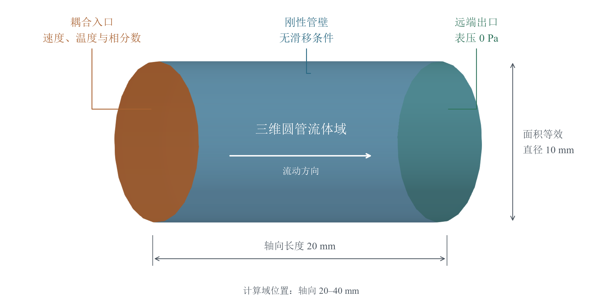

管路由上游一维段和下游三维段串联组成，两段截面积一致，流量在耦合截面连续。图 3 给出管段尺寸、区域划分和主流方向。

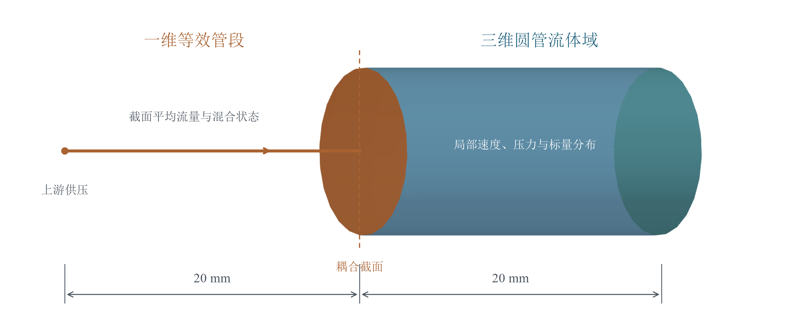

一维段计算截面平均流速及管路惯性、沿程阻力，三维段解析速度与压力的空间分布。每次耦合运行都由这一对模型完成双向交换：一维状态成为三维入口条件，三维入口的面积平均压力返回一维。两个方向在同一耦合截面上闭合流量与背压的反馈关系。

阀门采用一维附加阻力表示，开度变化通过阻力系数影响流量。温度和相分数在一维侧由充分混合容积更新，再作为三维入口的标量状态。混合容积是具有储存作用的集中参数单元，其容积单独给定；两段水力管路的轴向总长为 40 mm。三维计算域为圆管流体区域，管壁按刚性壁面处理。

圆管几何便于建立速度和压降参考解，但三维段仅长两个管径，因此验证在入口指定充分发展抛物线剖面，并用相同剖面初始化流场。后续对瞬态压力的解释同时考虑这一入口假设和短管端部效应。

### 2.2 网格划分与截面积一致性

三维区域采用五块结构化六面体网格：中心块连接四个外围块，沿轴向拉伸形成圆管。"6/40"表示每个截面块两个方向各划分 6 个单元，轴向划分 40 层，共 7,200 个体单元。图 4 左侧为圆管表面网格，右侧为由 180 个边界面组成的耦合入口截面。

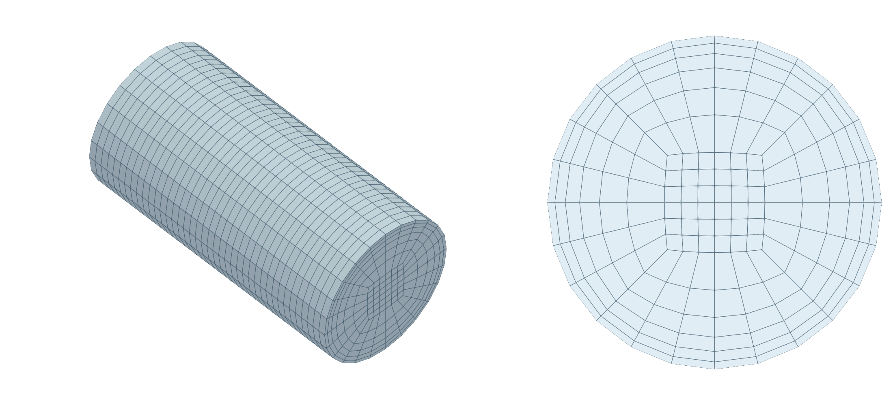

网格用平面面元逼近圆周，离散入口面积会与名义圆面积产生微小差异。计算前对横向网格坐标作统一缩放，使离散入口面积等于 $\pi R^{2} = 78.5398\text{ mm}^{2}$，轴向位置保持不变。图 4 所示网格的外缘节点半径约为 5.029 mm，名义面积等效半径仍为 5 mm。入口速度剖面还按实际面元面积归一化，使其积分流量对应一维输出。

稳态水力算例采用 8/40 和 12/80 两档网格，分别包含 12,800 和 57,600 个体单元；标量输运的网格研究采用 6/40 和 8/80，对应 7,200 和 25,600 个体单元。各算例保留相同的圆管构型，以观察分辨率变化对误差和耗时的影响。两档网格用于比较分辨率提高后的精度与计算代价。

### 2.3 材料参数及选取依据

流体采用定密度、定黏度的不可压缩层流模型。密度取 $\rho = 1000\ \text{kg/}\text{m}^{3}$，运动黏度取 $\nu = 10^{- 5}\text{ m}^{2}\text{/s}$，相应动力黏度为 $\mu = 0.01\ \text{Pa⋅s}$。名义平均速度为 $0.1\ \text{m/s}$，按管径计算的 Reynolds 数为 100，使验证处于层流范围，并可使用圆管解析关系检查流量与背压。表 1 汇总几何、材料和公共求解参数。

|            **参数**            |              **值与约定**              |
|:------------------------------:|:--------------------------------------:|
|          面积等效半径          |                  5 mm                  |
|          1D / 3D 长度          |                各 20 mm                |
|         密度、运动黏度         |      1000 kg/m³、$10^{- 5}$ m²/s       |
|       供压、远端出口压力       |           表压 12.8 Pa、0 Pa           |
| 名义平均速度、直径 Reynolds 数 |              0.1 m/s、100              |
|       热容、显热参考温度       |          1000 J/(kg·K)、300 K          |
|            混合容积            | $7.853981633974484 \times 10^{- 7}$ m³ |
|        温度初值/供给值         |              300 / 320 K               |
|        相 A 初值/供给值        |               0.2 / 0.8                |
|     控制周期、压力耦合容限     |       1 ms、相对容限 $10^{- 4}$        |
|            求解模式            | 串行隐式、Aitken、每窗口最多 60 次迭代 |

: 表 1 公共几何物性与求解设置

温度与相分数试验使用等物性、同速的两相理想化模型，两相共用上述密度和黏度，比热容均取 $1000\ \text{J/}\left( \text{kg⋅K} \right)$。这些数值构成便于解析验证的参数组，不对应实际气液两相的完整物性。温度和相分数随流动输运，其变化不反过来改变密度与黏度；模型不包含相变、相间滑移或浮力效应。

温度初值与供给值分别为 300 K 和 320 K，相 A 体积分数初值与供给值分别为 0.2 和 0.8，用于产生幅度明确的标量变化。热扩散系数和相分数扩散系数均取零，使无源项算例能够按特征线构造参考解。两种标量满足相同结构的输运方程，因此其归一化误差趋势可相互印证，验证范围仍受这些共同假设限定。

混合容积取 $7.853981633974484 \times 10^{- 7}\text{ m}^{3}$，在名义流量下对应 0.1 s 的混合时间常数。该时间尺度与 0.12 s 的输运算例时长相近，便于在一次计算中观察入口状态的逐步变化及其向三维管段传播的过程。

### 2.4 物理边界条件与接口对应

水力边界采用上游供压、三维入口给定速度、三维远端给定压力的组合。上游表压为 12.8 Pa，远端出口表压为零；在名义流速下，两段等长圆管的解析压降各为 6.4 Pa，总压降与供压相符。这样的设置使接口压力具有明确的参考值，也避免在耦合截面同时独立指定流速和压力。表 2 列出物理算例的主要边界条件。

| 位置 | 水力边界 | 温度与相分数边界 |
|:------------:|:---------------------------:|:---------------------------:|
| 一维上游 | 供压为 12.8 Pa；阀门开度决定附加阻力 | 供给温度 320 K，相 A 体积分数 0.8，经混合容积更新出口状态 |
| 耦合截面及三维入口 | 一维平均流速展开为抛物线剖面；三维求得接口压力并反馈 | 固定值随一维出口状态更新，在入口截面上均匀施加 |
| 三维远端出口 | 表压固定为零；速度采用零法向梯度 | 无源项算例采用零法向梯度 |
| 三维管壁 | 速度无滑移；压力采用零法向梯度 | 零法向梯度，且无穿透流量；本模型扩散系数为零 |

: 表 2 水力与标量输运的边界条件

三维入口速度由一维结果持续更新，压力使用与给定通量相容的外推边界。求解器计算得到的入口压力按面元面积平均后返回一维。OpenFOAM 中的压力除以了密度，反馈时乘以相同密度恢复为 Pa；两侧均以远端出口零表压为参考。因此，压力反馈与流量输入对应同一位置、同一压力基准。

温度和相分数入口值按请求的物理时刻读取，比较时也使用同一时刻的一维状态。壁面条件与零扩散假设共同使标量变化来自对流输运。制造解诊断另采用与指定解析梯度一致的出口条件，并配套加入源项；其用途是检查数值离散，相关结果在第 5 章单独讨论。

### 2.5 初始状态与时间设置

稳态水力及无源项输运算例从名义平均速度 0.1 m/s 启动。三维初始速度采用与入口一致的归一化抛物线剖面，压力沿管段按名义压降初始化，温度和相分数分别设为 300 K 和 0.2。这样可减弱与验证目的无关的启动调整，使稳态水力比较集中于空间误差，使标量算例集中于入口状态变化后的输运过程。

阀门控制算例在相同圆管上改变一维附加阻力，开度在 50 ms 从 1 降至 0.4，并于 80 ms 恢复为 1。控制事件安排在 1 ms 的仿真时间网格上，在对应物理时刻的方程推进前生效。两侧通过共同交换窗口协调各自内部步长，窗口未收敛时恢复起点状态并重算；控制、混合状态和边界数据随同重放。

不同试验分别改变网格、内部步长、交换窗口或松弛参数，具体设置随各节结果给出。下文先用两个解析算例判断水力与标量精度，再通过阀门控制、参数探索和运行可靠性试验解释误差来源与计算成本。

## 3 算例 A 稳态层流圆管

稳态圆管层流具有明确的速度与压降解析关系，适合首先检查一维流量和三维背压能否形成正确的水力闭环。该算例采用固定边界条件，使时间变化的影响减弱，并通过两档网格观察空间离散对误差及计算成本的作用。

无阀门附加阻力、充分发展圆管的解析结果为

$$u_{ref} = \frac{p_{\text{s}}R^{2}}{8\rho\nu(L_{1} + L_{3})} = 0.1\ \text{m/s}$$

$$p_{b,ref} = \frac{8\rho\nu L_{3}u_{ref}}{R^{2}} = 6.4\ \text{Pa.}$$

初始化为充分发展剖面，运行至 2 s；$H$=10 ms，一维最大子步 2 ms，三维最大子步 2.5 ms。误差使用末端一维平均速度及接口反馈压力相对解析值计算。

| **网格：单块径向/轴向** | **速度误差** | **压力误差** | **墙钟耗时** |
|:-----------------------:|:------------:|:------------:|:------------:|
|         8 / 40          |   0.37270%   |   0.37740%   |   35.186 s   |
|         12 / 80         |   0.15150%   |   0.14821%   |  204.656 s   |

: 表 3 稳态水力误差与计算耗时

速度与压力误差随网格加密下降：速度误差从 0.37270% 降至 0.15150%，压力误差从 0.37740% 降至 0.14821%。这表明提高空间分辨率能够同时改善一维平均流量与三维接口背压的计算精度。

为便于同时观察精度和成本，图 5 将两档网格的速度、压力误差与运行耗时并列展示。左图用于比较水力误差，右图用于判断网格加密带来的计算代价。

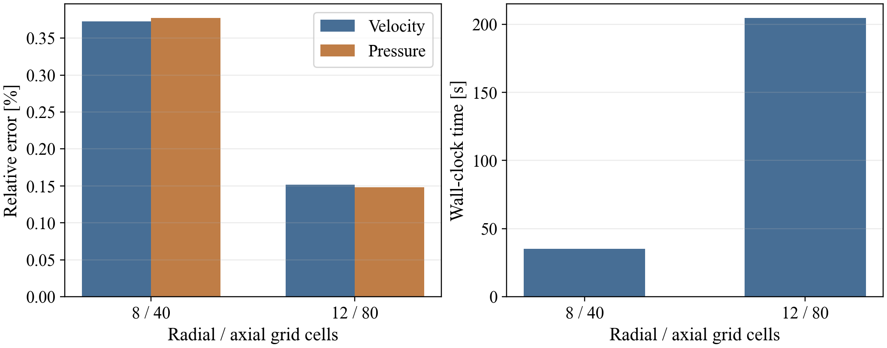

细网格同时降低了速度和压力误差，但运行耗时也明显增加。因此，网格选择需要结合关注的物理量和允许误差，不能只按单次运行速度判断配置优劣。

仅比较末端压力不能说明压降在空间上如何分布。图 6 因而沿轴向展示一维管段、三维管段及解析压力，用于检查耦合截面附近和下游区域的压力分布。

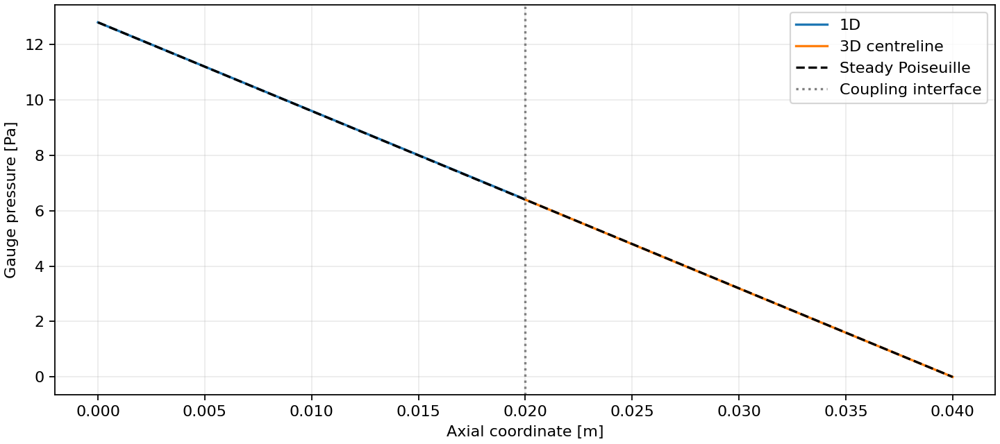

一维与三维压力沿共同轴向坐标展示后，可以直观看到接口两侧的衔接关系及下游压降。中心线压力用于描述空间变化，接口反馈仍按截面面积平均计算，二者的统计位置与含义应保持区分。

为观察稳态水力结果在三维域内的分布，图 7 给出 12/80 网格在 2 s 时的纵向速度与压力云图。截面通过管轴，左侧为三维入口，右侧为出口，上下边缘为管壁；轴向范围为 20～40 mm。后续纵向云图采用相同的观察方向。

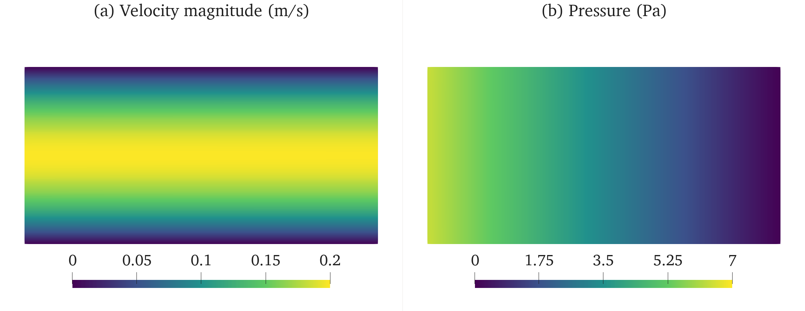

速度在管轴附近最大，向管壁逐渐减小，沿轴向的剖面形态基本保持一致；域内最大速度约为 0.199 m/s，与平均速度约 0.1 m/s 的层流抛物线分布相符。压力主要沿轴向递减，同一截面的径向差异较小。这些空间特征与前述速度及压降的定量误差结果一致。

## 4 算例 B 无源项温度及相分数瞬态输运

本算例用于检验一维输出的温度和相分数能否准确施加于三维入口，并在三维流场中形成正确的瞬态输运。采用无扩散、无源项的对流模型后，可以建立独立解析解，分别评价入口传递精度、域内场误差和接口累计收支。进一步比较两档网格与时间步长，判断提高分辨率能否改善计算结果。

### 4.1 验证目的与算例设置

温度从 300 K 向供给值 320 K 变化，相 A 体积分数从 0.2 向供给值 0.8 变化，入口状态由一维混合容积连续更新。计算物理时长为 0.12 s，交换窗口为 5 ms。6/40 网格采用一维最大子步 1 ms、三维最大子步 0.5 ms；8/80 网格将两侧最大子步分别缩小至 0.5 ms 和 0.25 ms。两组设置用于比较空间与时间联合细化的效果。

### 4.2 解析参考与评价指标

圆管内不同径向位置的流速不同，入口状态到达域内各点的时间也不同。以名义充分发展速度剖面构造参考解：

$$U_{z}(r) = 2u_{ref}(1 - r^{2}/R^{2}).$$

混合容积的入口状态为 $Y_{in}(t) = Y_{\text{s}} + (Y_{0} - Y_{\text{s}})e^{- t/\tau}$，$\tau = V_{\text{m}}/(Au_{ref}) = 0.1$ s。三维初始状态为 $Y_{0}$，无扩散、无体源项，沿特征线有

$$Y(r,z,t) = Y_{\text{s}} + (Y_{0} - Y_{\text{s}})exp\left\lbrack - \frac{max(0,t - (z - L_{1})/U_{z}(r))}{\tau} \right\rbrack.$$

壁面零速度处保持初值。该式直接由 $\partial_{t}Y + U_{z}(r)\partial_{z}Y = 0$ 推导，未使用计算所得标量拟合，也没有人为源项。计算中的实际水力速度和一维混合状态会有离散误差，全部保留在与名义解析解的比较中。

在各单元中心计算解析值，与数值结果作体积加权均方根误差（RMS）比较，并取全时段最大值评价场精度。该指标同时包含水力状态、混合状态及空间时间离散的影响。三维入口的应用误差则按同一物理时刻的一维输出计算，用于单独检查边界数据传递。

### 4.3 结果与数据分析

两档计算的误差与耗时见表 4。6/40 网格的最大温度场 RMS 为 0.501090 K，相分数场 RMS 为 0.0150327，分别约占各自输入变化幅度的 2.51%；细化后，两项误差分别降至 0.317666 K 和 0.00952999。

试验预设温度场 RMS 小于 1 K、相分数场 RMS 小于 0.03，并要求全部交换窗口收敛、相分数保持有界、标量累计接口残差小于 1%。两档计算均满足这些条件。

| **网格/三维最大子步** | **最大温度场 RMS** | **最大相分数场 RMS** | **显热接口累计偏差** | **墙钟耗时** |
|:---------------:|:------------:|:------------:|:------------:|:------------:|
| 6/40，0.5 ms | 0.501090 K | 0.0150327 | 0.347173% | 13.269 s |
| 8/80，0.25 ms | 0.317666 K | 0.00952999 | 0.173931% | 56.771 s |

: 表 4 无源项标量输运的细化结果

细化后，两项场误差均下降约 36.6%，归一化误差降至约 1.59%；显热接口累计偏差从 0.347173% 降至 0.173931%，下降约 49.9%。与此同时，完整运行耗时从 13.269 s 增至 56.771 s，约为原来的 4.28 倍。细化提高了精度，也增加了计算代价。入口温度和相分数的最大应用误差分别约为 $1.65 \times 10^{- 12}$ K 和 $2.44 \times 10^{- 15}$，远小于域内场误差，说明本组结果的主要误差出现在物理输运与离散计算过程中。

图 8 给出场误差随时间的变化。该时间历程用于判断误差是否只集中在某个瞬间，以及细化是否在整个输运过程中持续改善结果。

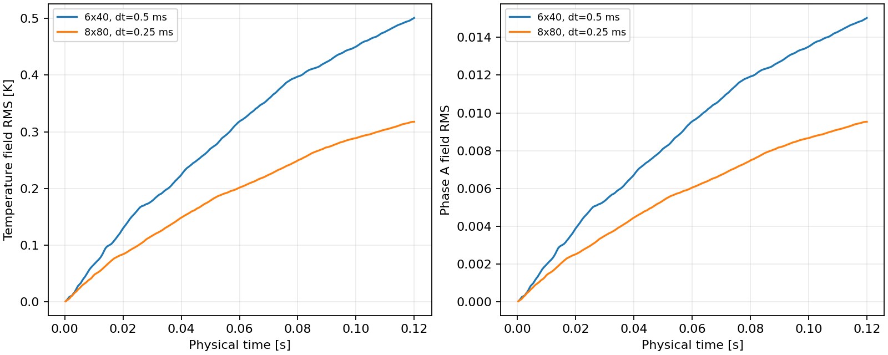

随着入口状态向域内传播，场误差逐步积累；细化后的误差曲线在输运过程中整体低于原配置。温度与相分数的归一化曲线接近，是因为两者采用相同结构的输运方程和等物性假设。两条曲线反映了同一类输运机制下的数值表现。

场误差曲线反映整体偏差，温度和相分数云图则展示入口状态在管内的传播形态。图 9 对应 8/80 网格、三维最大子步 0.25 ms，在 0.12 s 时给出通过管轴的纵向分布。两幅图的色标分别对应温度和相 A 体积分数。

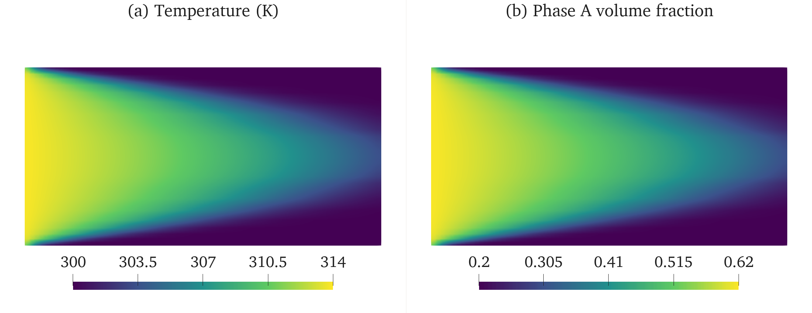

温度较高、相 A 体积分数较大的流体从入口进入，并沿管轴附近较快地向下游推进；近壁流速较低，仍有较大区域接近初始状态，形成向下游伸展的弯曲过渡带。温度与相分数的空间形态相似，与二者采用同速、等物性被动输运方程的设置一致，也从局部分布上解释了归一化误差曲线接近的原因。

## 5 制造解与接口守恒验证

为检验标量方程的离散实现及一维与三维接口的积分一致性，本章采用预先指定解析场、并加入匹配源项的制造解方法。首先比较计算场与指定解析场的偏差，再对每个收敛窗口的质量、动量和能量交换进行积分，评价两侧在同一物理时间区间内的收支一致程度。

制造解仍采用 $Y = Y_{\text{s}} + (Y_{0} - Y_{\text{s}})e^{- t/0.1} + g_{Y}(z - L_{1})$，$g_{T} = 100$ K/m、$g_{\alpha} = 1$ /m，并显式施加匹配源项。最大温度场 RMS 为 0.0234582 K，相分数为 0.000743302。源项使用实际速度场构造，制造解用于标量离散诊断。

表 5 汇总制造解工况的接口累计相对残差。质量与相分数反映物质交换的一致性，压力力及对流动量反映水力传递的一致性，显热、动能与压力功分别反映能量交换的不同组成。

|           **量**           | **累计相对偏差** |
|:--------------------------:|:----------------:|
|            质量            |    0.000503%     |
|            显热            |    0.347173%     |
|            相 A            |    0.192768%     |
|         压力力冲量         |    0.021498%     |
|   对流动量，连续系数 4/3   |     1.15056%     |
| 对流动量，实际离散剖面系数 |    0.001006%     |
|    动能通量，连续系数 2    |     2.42478%     |
| 动能通量，实际离散剖面系数 |    0.001509%     |
|           压力功           |    0.418603%     |
|  显热 + 动能通量 + 压力功  |    0.347169%     |

: 表 5 制造解工况的接口收支残差

质量和压力力冲量的累计相对残差分别为 0.000503% 和 0.021498%，说明流量传递及截面压力力积分具有较好的一致性。相 A 和显热残差分别为 0.192768% 和 0.347173%，均低于本试验设定的 1% 检查门槛，表明标量交换在该时间区间内保持了较小的累计收支偏差。

采用连续抛物线系数时，对流动量和动能通量残差分别为 1.15056% 和 2.42478%；采用实际离散剖面系数后，分别降至 0.001006% 和 0.001509%。这一变化表明，入口面元上的离散剖面与连续解析剖面的积分系数差异，是上述两项残差的重要来源。压力功残差为 0.418603%，总能量通量残差为 0.347169%，后者接近显热残差，反映了本工况中显热在总能量交换中的主导作用。各分项共同给出了接口物质、水力与能量交换的一致性水平。

接口收支同时采用累计净残差、各窗口绝对残差之和及最大单窗口残差评价，以区分正负误差抵消后的总体偏差与局部误差的累积程度。

## 6 交换频率对计算结果与耗时的影响

交换频率决定一维与三维模型在单位仿真时间内更新边界信息的次数。本章以阀门关闭和恢复造成的流量扰动为对象，比较不同交换频率下的速度、压力、温度和相分数轨迹，并记录完整运行耗时。试验关注两个问题：提高交换频率能否减少结果差异，以及精度变化需要付出多少计算代价。

### 6.1 试验设置与比较方法

阀门开度在 50 ms 从 1 降至 0.4，于 80 ms 恢复为 1，计算持续至 0.12 s。阀门变化通过一维附加阻力影响流量，三维压力再反馈至一维，形成瞬态水力响应；温度和相分数随变化后的流动输运。各档采用相同的几何、物性和控制时刻。

交换窗口 $H$依次为 0.0625、0.125、1、5、10 ms，对应交换频率 16,000、8,000、1,000、200、100 Hz。一维最大内部步长设为 0.25 ms，三维设为 0.125 ms。以最短窗口的计算轨迹作为数值参考，在共同时间范围内比较各变量的 RMS 差异，并按参考信号的全时段极差归一化。该比较衡量配置间差异，参考轨迹本身仍包含数值误差。

当交换窗口短于最大内部步长时，求解器必须缩短实际子步以到达窗口端点。因此，两档最短窗口也改变了有效时间分辨率。本试验评价交换窗口与实际时间步共同作用下的计算表现；频率变化的影响不能与时间积分误差完全分离。每档先运行一次，重复运行结果在第 10.2 节给出。

### 6.2 结果差异与计算代价

表 6 列出五档配置的归一化差异、完整运行耗时和试算放大倍数。试算放大倍数是试算子步数与最终接受子步数之比，用于衡量隐式迭代增加的工作量。图 10 展示这些结果随交换频率的变化。

| $$H$$ | **频率** | **流速 RMS 差** | **背压 RMS 差** | $T$**/**$\alpha$ **RMS 差** | **总耗时** | **试算/接受子步** |
|:-------:|:-------:|:---------:|:---------:|:---------:|:----------:|:----------:|
| 0.0625 ms | 16000 Hz | 对照 | 对照 | 对照 | 107.252 s | 1.904 |
| 0.125 ms | 8000 Hz | 0.004925% | 1.42664% | 0.000301% | 63.039 s | 2.128 |
| 1 ms | 1000 Hz | 0.016327% | 2.67572% | 0.001054% | 71.057 s | 2.608 |
| 5 ms | 200 Hz | 0.074800% | 2.66629% | 0.004209% | 83.659 s | 3.125 |
| 10 ms | 100 Hz | 0.012880% | 2.67070% | 0.001124% | 88.224 s | 3.500 |

: 表 6 交换频率与精度效率统计

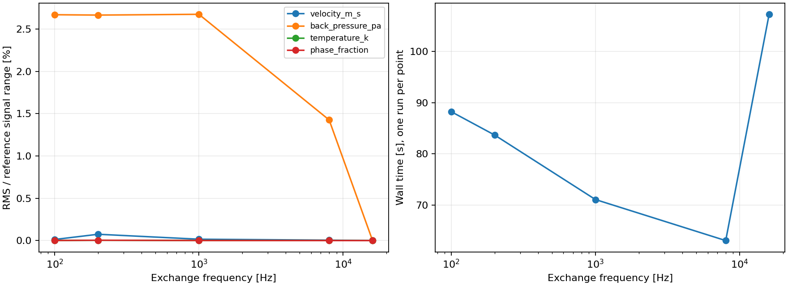

从 100 Hz 提高至 8,000 Hz，压力归一化 RMS 差由 2.67070% 降至 1.42664%，但中间频率的变化并不单调。速度、温度和相分数的差异也未随频率单调下降，说明各变量对时间离散与控制事件采样的敏感程度不同。与最短窗口数值参考的差异减小，只能说明轨迹更接近该参考，不能直接等同于真实物理误差的减少。

耗时同样没有随交换次数减少而持续降低。8,000 Hz 配置本次耗时为 63.039 s，16,000 Hz 为 107.252 s；当频率降至 100 Hz 时，耗时仍为 88.224 s。低频配置的窗口较长，试算放大倍数由最短窗口的 1.904 增至 3.500，抵消了部分交换次数减少带来的收益。因此，需要同时考察实际子步数量和隐式迭代次数。

### 6.3 阀门切换附近的压力差异

压力在阀门切换时迅速变化，采样时刻的轻微差异也可能产生较大的点值偏差。图 11 给出压力时间历程及关闭事件附近的局部结果，用于判断全时段误差是否主要来自控制切换附近。

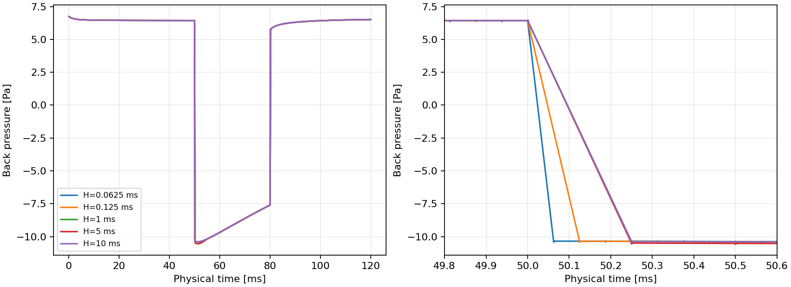

以 1 ms 窗口为例，全时段压力归一化 RMS 差为 2.6757%，最大差约为 12.59 Pa，出现在 50.0625 ms。诊断性地排除两个控制事件前后各 1 ms 后，RMS 差降至 0.03793%。这说明差异主要集中在切换附近：压力快速变化时，跨事件线性插值和不同子步采样时刻会放大点值差。表 6 仍采用完整时间段的指标，局部排除仅用于解释误差来源。

本组试验表明，交换频率需要与内部步长及隐式迭代共同选择。较高频率能够更细致地分辨控制切换，但计算代价增加；较低频率也可能因迭代增多而耗时更长。8,000 Hz 在本次单次扫描中耗时最低。第 10.2 节通过重复运行进一步比较了 8,000 Hz 和 1,000 Hz 配置的耗时波动。

阀门切换引起的水力扰动还会改变标量在三维管段内的输运。图 12 给出 1 ms 交换窗口工况在 0.12 s 时的四项物理场，此时阀门已于 80 ms 恢复全开。速度、压力、温度及相分数分别采用与前述同类云图一致的色标范围，以便比较其分布及量级。

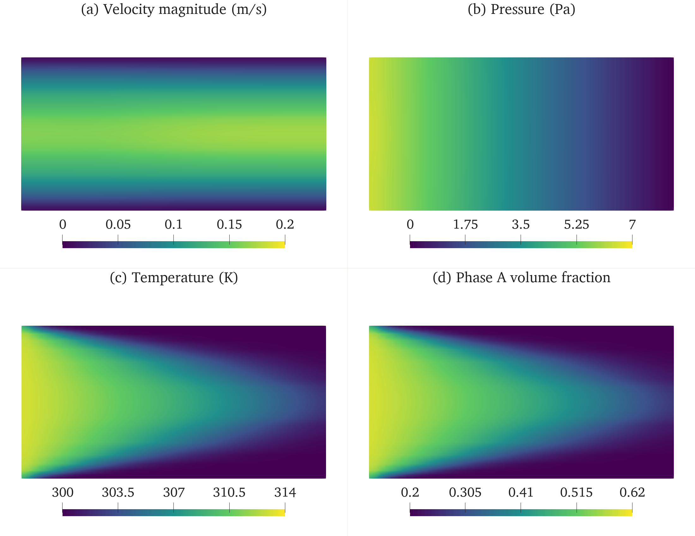

该时刻管轴附近仍保持较高流速，域内最大速度约为 0.171 m/s，低于稳态算例约 0.199 m/s 的水平，说明恢复开度后流动仍处于调整过程。压力沿管长下降，温度和相分数在中心区域的传播更快，近壁区域保留较低值。四项场分布表明，阀门控制既影响水力状态，也通过流速变化影响后续标量输运。

## 7 计算耗时与数据交换延迟分析

第 6 章比较了不同交换频率下的总耗时，本章进一步分析时间消耗在哪些环节，以及边界数据从写出到接收使用需要多久。计算耗时用于评价整体效率，交换延迟用于评价数据更新的及时性；两者均按实际经过的时间统计。

### 7.1 计算耗时构成

以 1 ms 窗口的阀门试验为例，完整运行耗时 71.057 s，包含启动、网格准备、求解和结果保存。一维计算循环耗时 63.201 s，其中压力读取 0.0430 s、模型与控制计算 0.0467 s、数据写出及时间记录 0.2690 s、耦合推进等待 60.9473 s，其余时间用于日志、回滚和退出。

耦合推进等待约占一维循环耗时的 96.4%，其中同时包含三维求解、隐式迭代和两侧同步。因此，三维求解工作量与耦合迭代次数是解释本工况整体计算效率的主要因素。

本次用 71.057 s 完成 0.12 s 的物理过程，实际耗时约为模拟物理时长的 592 倍。毫秒级控制事件按仿真时间轴执行，计算性能则由上述实际耗时评价。

### 7.2 双向数据交换延迟

交换延迟从源数据写出计至接收侧首次可用，统计中包含初始化、试算、时间记录及进程调度的影响。表 7 给出 1 ms 窗口下的双向统计，延迟单位均为 ms。中位数反映典型水平，95% 和 99% 分位数反映大多数样本的等待范围，最大值反映偶发长等待。

| **方向** | **样本数** | $$p_{50}$$ | $$p_{95}$$ | $$p_{99}$$ | **最大** |
|:--------:|:----------:|:----------:|:----------:|:----------:|:--------:|
| 1D → 3D  |    313     |   1.308    |   2.339    |   3.037    |  4.183   |
| 3D → 1D  |    313     |   1.197    |   20.986   |   23.190   | 298.610  |

: 表 7 双向端到端延迟统计

1 ms 窗口下，正向和反向各统计 313 个样本。正向中位数为 1.308 ms、95% 分位数为 2.339 ms；反向分别为 1.197 ms 和 20.986 ms，最大值达到 298.610 ms。两方向的典型延迟接近，反向却存在更长的尾部等待，说明压力反馈的及时性还受到对端求解与同步状态的影响。

五档频率试验的正向 95% 分位数为 2.218～3.668 ms，反向为 12.009～23.986 ms，最大延迟为 337.015 ms。这些数据反映完整计算中的端到端交换行为。通信框架在不含 CFD 求解条件下的独立测量见第 11.6 节。

## 8 试验条件与结论适用范围

本报告的精度结论取决于所采用的物理模型、边界条件及离散设置，耗时和交换延迟还受到硬件与系统负载影响。本章集中说明这些条件，以明确前述结果可用于评价的范围。

### 8.1 软件环境与执行方式

试验采用 OpenFOAM v2512、preCICE 3.4.1、Python 3.12.3 和 GCC 13.3.0。软件及依赖在固定容器环境中运行。容器可见 20 个逻辑 CPU，三维求解器采用单进程计算，一维模型与其作为两个耦合参与者协同执行。

报告中的耗时和延迟均为本机环境下的实测结果。相同配置的重复运行也会因主机负载和调度发生变化，因此性能比较结合重复试验的范围进行分析。

### 8.2 物理模型与验证范围

两个解析算例分别验证稳态圆管水力和温度、相分数的无源项输运，控制试验验证同一对一维与三维模型的双向反馈及事件时序。模型采用刚性管壁、不可压缩层流、等物性与同速假设；温度和相分数作为被动标量，适用范围不包含物性随状态变化、相间滑移或相变。

三维管段长径比为 2，入口指定充分发展剖面，瞬态压力同时受到入口剖面及短管端部条件的影响。运行试验覆盖 2 s 物理时间和 20 次阀门动作，并通过故障注入检查受控退出及从相同初始条件重新运行的可重复性。

## 9 运行完整性与接口守恒

运行完整性是解释误差结果的前提，接口守恒则用于检查两侧交换是否产生额外的收支偏差。本章先核查终止时间、窗口收敛和控制事件，再分析阀门工况下的质量、标量与能量交换。

### 9.1 运行完整性与控制时序

完整性检查先确认求解是否到达规定终止时间、窗口是否收敛、控制事件是否按序执行。只有这些条件满足，后续的场误差和性能统计才具有可比意义。

21 项单元测试全部通过，覆盖混合状态更新、零流量处理、回滚恢复、控制时序、输入检查和接口积分。各算例另检查接受时间单调性、规定终止时间、窗口收敛、相分数范围及误差门槛。

解析验证、制造解与五档频率扫描共完成 10 次耦合运行，累计 3,508 个收敛窗口。第 10 章的探索试验完成 16 次运行、7,920 个收敛窗口；第 11 章的综合试验完成 9 次完整运行、8,744 个收敛窗口。各组完整运行均通过相应检查。

五档阀门试验各包含两个控制事件，最大时间注入误差为 $1.92 \times 10^{- 15}$ s，属于浮点舍入范围。

频率扫描中最短通过的交换窗口为 62.5 μs；扩展试验的 31.25 μs 窗口完成了 0.12 s 物理过程和 3,840 个收敛窗口，表明该配置可在所测工况下持续完成双向交换。

### 9.2 阀门工况的接口守恒

为检验控制引起的流量变化是否影响接口收支，对 1 ms 窗口的阀门工况统计累计相对残差、窗口绝对残差和的相对值，以及最大绝对窗口残差。表 8 同时给出这三类指标，使总体净偏差和局部偏差均可辨认。

| **量** | **累计相对残差** | **窗口** $L^{1}$ **相对残差** | **最大绝对窗口残差** |
|:----------------:|:---------------:|:---------------:|:--------------------:|
| 质量 | 0.010375% | 0.013277% | $4.06 \times 10^{- 9}$ kg |
| 显热 | 0.079693% | 0.079728% | $9.76 \times 10^{- 5}$ J |
| 相 A | 0.038236% | 0.043953% | $2.91 \times 10^{- 9}$ kg |
| 压力力冲量 | 0.017840% | 0.038192% | $3.43 \times 10^{- 9}$ kg·m/s |
| 压力功 | 1.16543% | 1.22692% | $2.78 \times 10^{- 9}$ J |

: 表 8 阀门算例的窗口守恒统计

为检查正负残差是否相互抵消，图 13 同时展示累计残差和各窗口绝对残差的合计。两种统计量应结合阅读，分别反映净收支偏差和局部误差的累积程度。

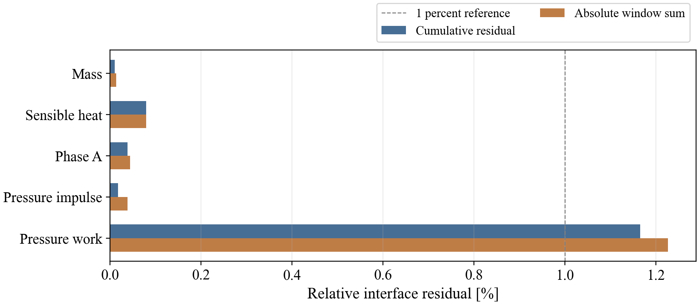

压力功的累计相对残差为 1.16543%，高于质量和显热等分项；其最大绝对窗口残差较小，反映了本工况压力功能量尺度较低的特点。结合相对值和绝对值，可以识别不同交换量的偏差来源及量级。

## 10 探索试验与优化结果

在基本算例通过检查后，还需要判断误差主要来自空间离散、时间积分还是耦合迭代。探索试验围绕这些因素分别改变配置，并通过重复运行区分数值轨迹差异与墙钟时间波动。

探索试验围绕空间分辨率、时间步长、交换周期和松弛参数进行，共完成 16 次运行、7,920 个收敛窗口。所有试验在同一容器环境中顺序执行，并采用预先确定的评价指标，以比较误差、重复性、迭代效率及稳定运行范围。

### 10.1 分别细化时间与空间

同时加密网格和缩小时间步虽然可能降低误差，却难以判断两者各自的贡献。因此，本组试验分别改变时间分辨率和空间分辨率，其余设置保持一致，再比较场误差与接口积分残差。

固定交换窗口 $H = 5$ ms，时间研究保持 6/40 网格，每次将一维和三维步长同时减半；空间研究保持原时间步长，仅将网格改为 8/80。三维最大场误差及显热接口累计相对残差如下。

| **网格** | **一维步长 ms** | **三维步长 ms** | **最大温度场 RMS K** | **最大相分数场 RMS** | **显热累计残差** |
|:------------:|:-------:|:-----------:|:-----------:|:-----------:|:-----------:|
| 6/40 | 1 | 0.5 | 0.501090 | 0.01503270 | 0.347173% |
| 6/40 | 0.5 | 0.25 | 0.492815 | 0.01478446 | 0.173877% |
| 6/40 | 0.25 | 0.125 | 0.488717 | 0.01466152 | 0.087011% |
| 8/80 | 1 | 0.5 | 0.329248 | 0.00987744 | 0.347280% |

: 表 9 时间与空间单因素细化结果

只减小时间步至四分之一，场误差降低 2.47%；只加密网格，场误差降低 34.29%。本组配置下，场误差改善主要由空间细化贡献；显热累计残差随时间步减半近似减半。这些结果为按精度目标选择细化方式提供了依据。

图 14 汇总单因素细化结果，将物理场误差与显热接口残差并列展示，从而帮助区分空间分辨率和时间积分对两类误差的作用。

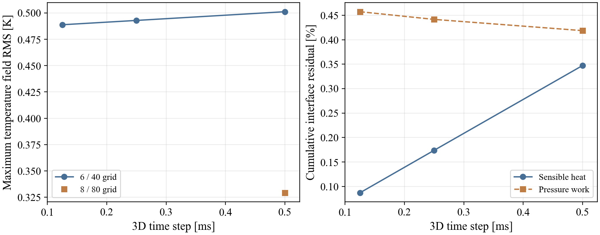

为定位不同细化方式改善的区域，图 15 比较三组试验在 0.12 s 时的温度绝对误差。误差为数值温度与第 4.2 节解析温度之差的绝对值，三幅图共用 0～3 K 色标。图中依次为 6/40 网格与 0.5 ms 三维最大子步、同网格与 0.125 ms 子步、8/80 网格与 0.5 ms 子步；两侧内部步长按本节设置同步调整。

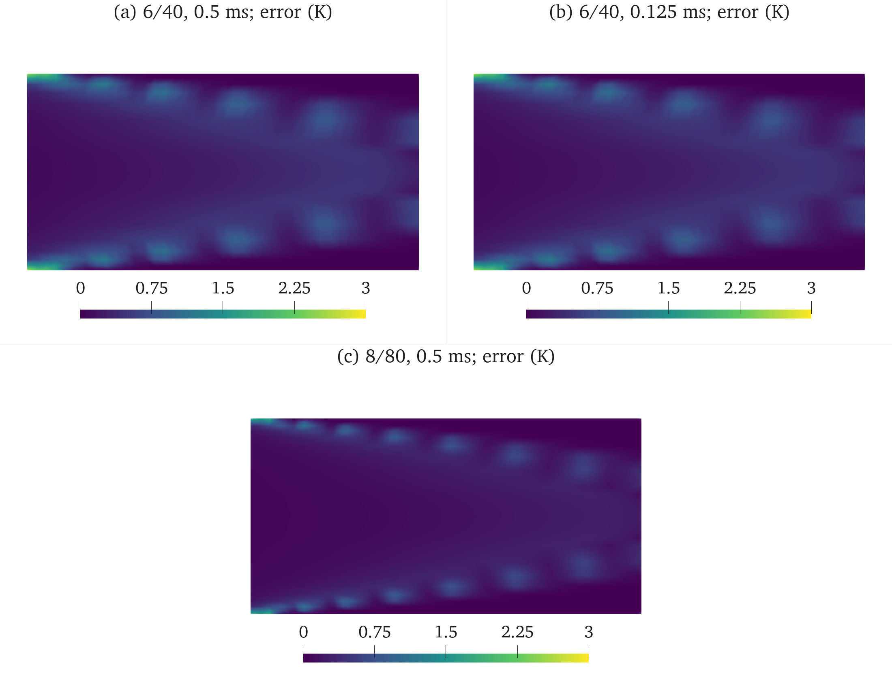

误差主要集中在入口近壁区域及标量过渡带附近。只减小时间步时，误差带的位置和强度变化较小；加密网格后，过渡带周围的较高误差区域收缩，域内大部分区域的误差降低。这与最大温度场 RMS 的变化一致：时间细化降低约 2.47%，空间细化降低约 34.29%，说明该工况的场精度更受空间分辨率影响。

### 10.2 交换周期的重复性与松弛参数探索

交换窗口既影响边界信息的更新频率，也可能截短内部时间步；松弛因子则主要改变隐式迭代的推进方式。为避免混淆这些作用，先对两档交换周期进行交错重复，再在固定窗口下筛选松弛参数。

固定 6/40 网格、一维最大步长 0.25 ms、三维 0.125 ms、物理时长 0.12 s，交错执行 0.125 ms 与 1 ms 两档窗口，每档三次。表中范围为实测最小至最大值，不是置信区间。

| **交换周期** | **次数** | **完整耗时中位数 s** | **实测耗时范围 s** | **试算与接受子步比均值** |
|:---------------:|:------------:|:------------:|:------------:|:------------:|
| 0.125 ms | 3 | 42.139 | 41.869 至 42.387 | 2.128 |
| 1 ms | 3 | 47.645 | 45.200 至 48.133 | 2.608 |

: 表 10 交换周期的重复运行统计

同配置的重复运行用于判断轨迹与耗时的可重复程度；耗时范围还受到主机负载和进程启动的影响。0.125 ms 窗口会截短实际一维子步，因此两档比较仍包含有效时间离散变化。

初始 Aitken 松弛因子开放为配置项，默认保持 0.2，合法范围为 $(0,1\rbrack$。固定 1 ms 窗口，筛选 0.5、0.8 两档；下表为同网格同误差容限的结果。

| **初始松弛因子** | **本表运行次数** | **试算与接受子步比** | **完整耗时 s** | **显热累计残差** |
|:---------------:|:------------:|:------------:|:------------:|:------------:|
| 0.2 | 3 | 2.608 | 中位数 47.645 | 0.079693% |
| 0.5 | 1 | 1.883 | 35.527 | 0.079692% |
| 0.8 | 1 | 1.883 | 35.929 | 0.079692% |

: 表 11 松弛参数筛选结果

图 16 通过重复耗时的散点与试算成本比较展示计算波动。散点的离散程度反映实际耗时范围，试算次数则提供较少受主机负载影响的迭代工作量指标。

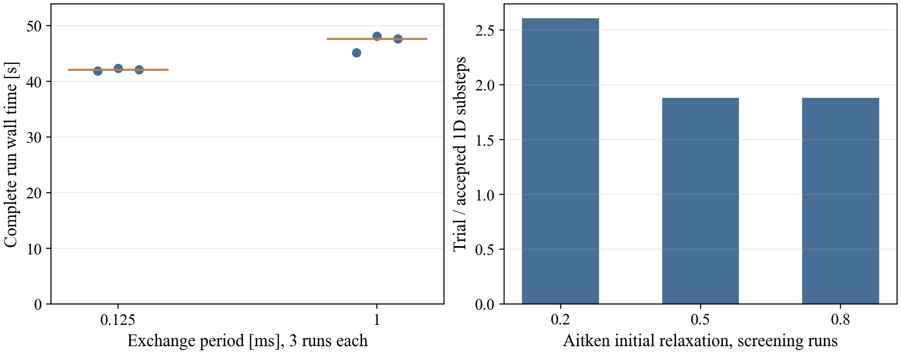

松弛参数比较以试算次数衡量迭代工作量，并结合重复运行的耗时范围评价实际效率。压力轨迹的一致性与迭代次数共同作为参数选择依据。

在多子步的 1 ms 窗口下，松弛因子 0.5 与 0.8 的压力最大归一化差达到 0.383496%，超过预设的 0.1% 一致性门槛。这说明迭代次数减少的同时，窗口内压力轨迹发生了不可忽略的变化。为判断差异是否由端点收敛不充分造成，另以松弛因子 0.5、相对收敛容限 $10^{- 5}$ 进行计算。

收紧容限后，压力最大差仍为 0.065717 Pa、归一化差为 0.383480%，未满足 0.1% 门槛；试算放大倍数为 2.058，完整耗时为 37.593 s。最大差出现在阀门恢复后的窗口内部，表明仅收紧端点判据未能保证全窗口轨迹一致。因此，多子步配置采用 0.2 的初始松弛因子，单子步窗口的参数影响在第 11.1 节单独评价。

### 10.3 压力功残差的可加分解

压力功同时依赖压力、流量以及它们在空间和时间上的对应关系。即使截面平均压力接近，局部压力与面流量的乘积积分仍可能不同。下面将总残差分解为时间轨迹项和空间投影项，用于判断进一步改进应侧重哪一环节。

压力功守恒以三维实际面压力与面流量乘积的积分为依据。同时计算同一三维轨迹上的面积平均压力投影，以识别空间分布带来的差异。定义

$$W_{A} = \sum_{j}^{}{\bar{p}}_{A,j}Q_{j}\Delta t_{j}$$

$$W_{3} = \sum_{j}^{}{\sum_{i}^{}p_{i,j}}Q_{i,j}\Delta t_{j}.$$

$$W_{1} - W_{3} = (W_{1} - W_{A}) + (W_{A} - W_{3}).$$

第一项包含时间积分及两个参与者轨迹差异，第二项是压力与流量空间分布的协方差投影差异。归一化采用各窗口一维压力功绝对值之和，分项保留符号。该分解使时间轨迹与空间投影对压力功偏差的贡献可以分别量化。

|       **工况**       | **时间与轨迹项** | **空间投影项** | **有符号总残差** |
|:--------------------:|:----------------:|:--------------:|:----------------:|
|      无源项基础      |    -0.021020%    |   0.439623%    |    0.418603%     |
| 无源项四分之一时间步 |    -0.008066%    |   0.465343%    |    0.457277%     |
|    无源项加密网格    |    -0.015016%    |   0.247265%    |    0.232249%     |
|      阀门 1 ms       |    -0.035641%    |   1.201073%    |    1.165432%     |

: 表 12 压力功残差分解

图 17 按相同归一化口径绘出压力功残差的各组成项。柱条保留正负号，用于判断空间投影与时间轨迹差异是相互增强还是部分抵消。

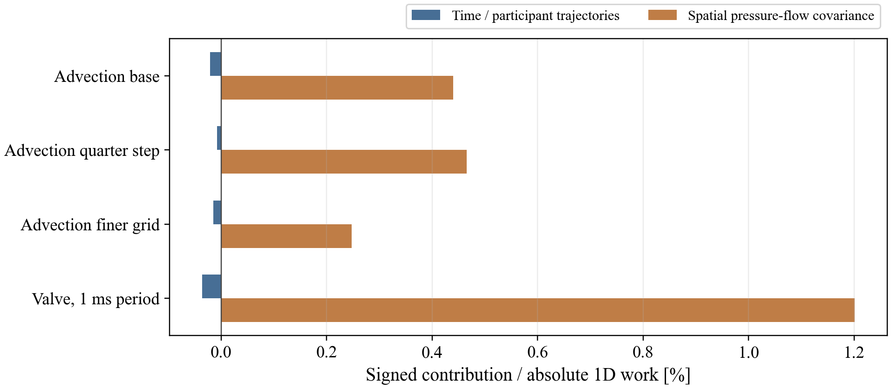

仅减小时间步未使压力功残差单调下降，而空间投影项在本组试验中占主要部分，加密网格能够降低该项。这说明压力功偏差不仅来自时间积分，也与接口上的压力和流量分布有关。

### 10.4 步长比例 更短窗口及延长控制试验

除常用配置外，还需要考察时间尺度差异更大、交换窗口更短以及控制动作重复出现时的行为。以下试验分别扩大这些设置的覆盖范围，结果按各自的工况和持续时间解释。

内部步长比例探索采用一维 1 ms、三维 0.125 ms、交换窗口 5 ms；完成 24 个收敛窗口，显热累计残差 0.078781%。该例说明 8 倍内部步长差在声明工况下可以运行，仍需按误差与成本选择比例。

31.25 μs 窗口下完成 3,840 个收敛窗口、0.12 s 物理过程，完整耗时为 110.085 s。该结果表明，缩短交换窗口后，耦合计算仍能在该试验时段内保持收敛并完成全部时间推进。

0.36 s 试验安排三组关闭与恢复，共 6 个控制事件，完成 360 个收敛窗口；最大控制时间误差为 $7.66\  \times \ 10^{- 15}$ s，显热累计残差为 0.020595%。结果表明重复动作在该时间范围内保持了时序一致性。更长的 2 s 循环和异常退出试验见第 11.3 节。

图 18 将多次关闭与恢复期间的平均流速和压力响应按时间排列，用于观察重复控制下的状态演化是否连续，并检查每次动作后的双向反馈。

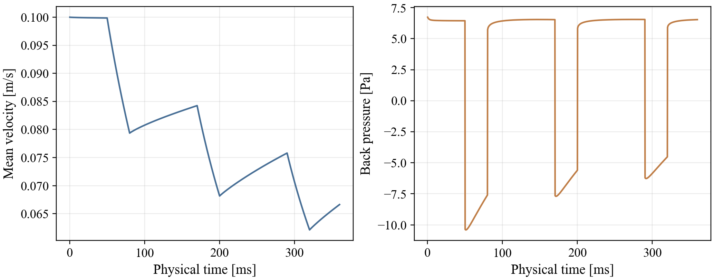

### 10.5 配置建议与适用范围

单因素试验表明，网格细化主要改善标量场精度，时间细化主要降低显热接口积分偏差；松弛参数则应在保持压力轨迹一致的前提下选择。压力功需要结合时间轨迹项与空间投影项分别评价。第 11 章进一步检验联合细化、持续循环及异常退出的效果。

精度配置可根据关注的指标选择：对域内标量分布要求较高时，优先细化网格；对累计热量交换要求较高时，优先缩小时间步。8/80 网格与四分之一时间步的联合效果在第 11.4 节给出。

## 11 综合性能验证

本节进一步检查压力轨迹的一致性、独立模型的差异以及异常情况下的退出与重跑行为。各项试验回答的问题不同，因此分别给出配置、比较对象和结论范围，并与前面的解析验证保持区分。

综合试验包含 9 次完整耦合运行，累计 8,744 个收敛窗口；另完成 2 次故障注入和 3 次独立通信测试。完整运行和故障测试均满足各自预设的检查条件。本章围绕压力轨迹一致性、模型敏感性、持续循环和异常退出展开，补充解析算例之外的运行性能评价。

### 11.1 单子步窗口与压力一致性

窗口内的多个子步可能包含端点收敛判据未充分反映的压力变化。将交换窗口与两侧子步统一，可以使接受端点覆盖全部离散采样时刻，从而更直接地评价松弛参数改变后的压力轨迹一致性。

1 ms 窗口内多子步的压力峰值差异无法仅靠收紧端点容限解决。为检查离散采样轨迹，将两侧步长及窗口统一为 0.125 ms，使接受窗口端点覆盖全部离散采样时刻。松弛因子 0.2 和 0.5 交错各重复 3 次；两组最大压力差为参考峰值的 0.004940%，通过预设 0.1% 门槛。速度归一化最大差为 0.000072%。同配置重复运行的物理轨迹最大差为 0。

| **初始松弛因子** | **试算放大倍数** |  **三次墙钟耗时 s**   |
|:----------------:|:----------------:|:---------------------:|
|       0.2        |     2.128125     | 58.02 / 63.96 / 83.29 |
|       0.5        |     1.661458     | 38.82 / 57.20 / 67.53 |

: 表 13 单子步配置的松弛参数比较

初始松弛因子由 0.2 改为 0.5 后，试算放大倍数下降 21.93%。单子步配置在降低迭代工作量的同时满足压力轨迹一致性门槛，因此采用 0.5；多子步配置采用 0.2。三次耗时的波动反映了实际运行环境对计算效率的影响。

图 19 将松弛参数下的压力轨迹比较与独立径向模型的参考结果放在一起。前者检验离散求解的一致性，后者帮助识别不同物理假设造成的响应差异。

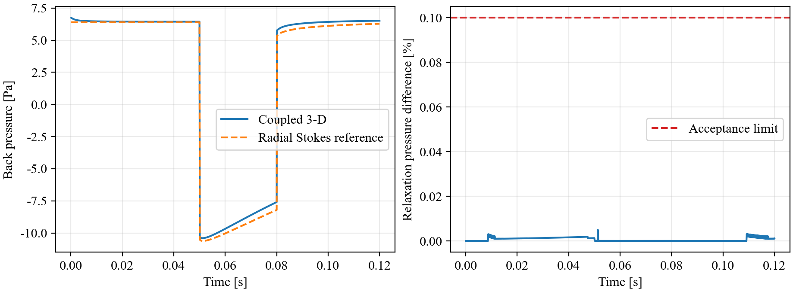

### 11.2 独立非定常径向模型

细窗口轨迹仍由同一套三维求解实现产生，难以单独揭示模型假设带来的差异。为提供另一种分析视角，本节引入独立径向非定常模型，并先检查其自身的网格收敛性，再讨论它与三维计算的差异。

采用独立的径向有限体积非定常 Stokes 模型，与上游一维惯性方程联立，分段恒定阀门区间采用矩阵指数推进，不调用原一维步进实现。径向扩散算子的稳态误差随网格加密呈二阶下降，并通过加权耗散测试。模型满足

$$\frac{\partial w}{\partial t} = \nu\frac{1}{r}\frac{\partial}{\partial r}\left( r\frac{\partial w}{\partial r} \right) + \frac{p_{b}}{\rho L_{3}}.$$

$$u = \frac{2}{R^{2}}\int_{0}^{R}wr\, dr$$

$$\rho L_{1}\frac{du}{dt} = p_{\text{s}} - p_{b} - \left( \frac{8\rho\nu L_{1}}{R^{2}} + \text{K}_{v}(a^{- 2} - 1) \right)u.$$

128 与 256 个径向单元的最大速度差为 $7.385\  \times \ 10^{- 7}$ m/s，最大背压差为 0.009225 Pa。256 单元参考与耦合三维轨迹的最大差分别为 0.001114 m/s 和 0.6118 Pa。径向模型允许速度剖面随时间变化，三维短管入口则指定抛物线剖面并包含端部效应。该比较揭示了瞬态响应对入口剖面与短管边界假设的敏感性。

### 11.3 长时循环和故障恢复

单次阀门动作只能验证有限时间段内的响应。持续循环用于观察误差与状态是否随重复动作积累，故障注入则用于检查一侧异常退出时另一侧能否及时停止。两类检查共同评价原型运行过程中的可靠性。

2 s 物理运行包含 20 次阀门动作、2,000 个窗口，覆盖 10 个名义三维管段停留时间，按实际积分流量折算为 4.79 次管内容积置换。全部窗口收敛，最大控制时间误差为 $1.046\  \times \ 10^{- 13}$ s，温度、相分数和守恒检查均通过，表明在重复控制过程中，两侧状态能够按共同仿真时序持续推进。

图 20 展示二十次阀门动作覆盖的连续时间历程，可据此观察控制时刻、响应幅值和循环过程中的状态变化。异常退出能力另由后面的故障注入试验检查。

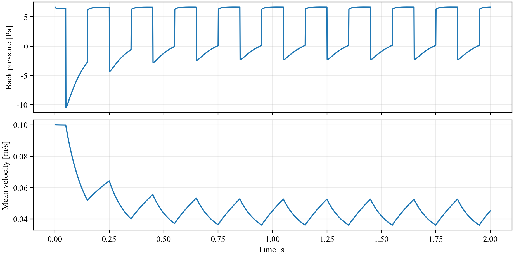

为检查单侧异常能否被及时传递，分别在运行中强制终止一维和三维参与者。下表记录已接受窗口数、注入后的进程停止时间及最终状态，用于评价异常退出是否受控。

| **故障注入** | **保留的接受窗口** | **注入后全部进程停止 s** | **检查结果** |
|:----------------:|:---------------:|:---------------:|:--------------------:|
| 强制终止一维参与者 | 20 | 0.1008 | 失败状态和日志保留 |
| 强制终止三维参与者 | 20 | 0.1088 | 失败状态和日志保留 |

: 表 14 参与者故障注入结果

故障注入后，两侧进程均及时停止，并保留已收敛窗口及故障状态。使用相同初始条件重新运行，所得轨迹与正常运行的最大差为 0，说明故障退出后可以完整重现该算例的计算结果。

### 11.4 网格与时间联合加密

单因素试验说明了空间和时间细化各自的作用后，还需要检查二者同时采用时是否仍能改善结果。本节据此组合网格与步长设置，并用相同的场误差和显热接口指标评价效果。

将网格从 6/40 加密至 8/80，同时将两侧时间步缩小至原来的四分之一，最大温度场 RMS 从 0.501090 K 降至 0.311888 K，下降 37.76%；显热接口累计相对残差从 0.347173% 降至 0.087038%，下降 74.93%。联合细化同时改善了场精度和接口热量积分，空间与时间各自的贡献仍需结合第 10.1 节的单因素试验解释。

在同一 8/80 网格上，图 21 比较三维最大子步为 0.5 ms 和 0.125 ms 时的温度绝对误差，两侧内部步长按比例缩小。两幅图均取 0.12 s，截面位置和 0～3 K 色标范围与第 10.1 节一致，用于观察空间分辨率提高后进一步减小时间步的作用。

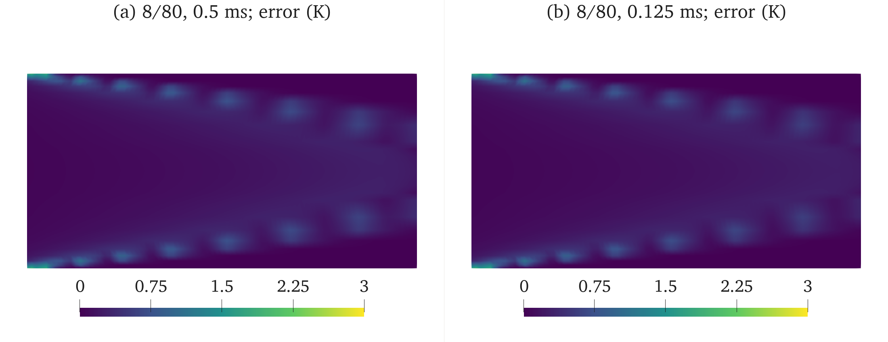

两组误差分布的主要位置相近，联合细化后局部误差有所降低；对应的全时段最大温度场 RMS 从单独空间细化的 0.329248 K 降至 0.311888 K，进一步降低约 5.27%。结合显热累计残差的变化可见，加密网格已改善了主要场误差，而继续缩小时间步还能提高时间积分精度，使场分布与接口热量收支同时得到改善。

### 11.5 系统能量审计

系统能量分析将外部输入输出、内部储能变化和耗散纳入共同收支关系，并将总残差分解为一维、三维及接口各项贡献，用于识别能量偏差在不同物理过程中的来源。

建立外边界总账，将一维水力惯性、独立混合容积与三维域的储能、外部通量及耗散汇总。机械耗散仍作为恒温环境的能量输出，未注入温度方程。接口差异不抵销成零，而保留为误差来源：

$$R_{mech,ext} = R_{mech,1} + R_{mech,3} - \Delta W_{interface} - \Delta F_{kinetic}.$$

$$R_{thermal,ext} = R_{mixing} + R_{thermal,3} - \Delta F_{thermal}.$$

单子步配置的机械能残差按连续抛物线动能通量计为供压功的 3.0963%；使用同一离散剖面通量后为 1.4921%，表明动能通量的离散表达对系统机械能收支具有明显影响。热量外边界残差为供给热量的 0.031166%，反映了较好的热量收支一致性。分解恒等式误差分别为 $1.32\  \times \ 10^{- 21}$ J 和 $1.96\  \times \ 10^{- 15}$ J，说明总收支与分项收支在数值上对应一致。

图 22 分别按供压功和供给热量归一化机械能与热量残差，展示两个能量尺度下的相对偏差。图中机械能残差高于热量残差，与前述分项分析的结果一致。

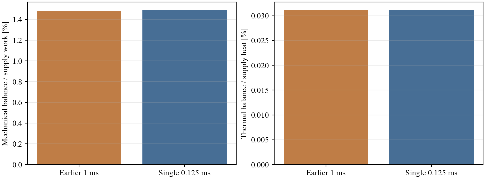

### 11.6 通信框架独立微基准

完整耦合运行中的等待时间包含三维物理求解，难以直接分离通信框架的增量成本。为此，采用保留实际通信框架但移去物理求解的双进程试验，测量限定交换规模下的读写、推进与调度成本。

采用 preCICE socket 双进程，在单顶点上交换速度三个分量、温度、相分数和反向压力。三次试验各运行 1,020 个窗口，排除前 20 个预热样本，并扣除本地数组操作的计时。测得框架平均增量分别为 871.38、773.71 和 800.12 μs/轮。该指标包含数据读写、推进及对端调度等待，反映所测交换规模下通信框架的运行成本。

## **12 总结与展望**

### **12.1 工作与试验概述**

本项目基于 preCICE 3.4.1 框架二次开发，建立了一维管路模型与 OpenFOAM 三维圆管模型的双向耦合计算流程。一维侧提供流速、温度和相分数，三维侧返回接口压力；同一对模型在统一交换窗口内完成边界更新、隐式迭代与回滚，并使毫秒级阀门控制事件与物理求解按仿真时间同步执行。

验证以稳态层流圆管和无源项温度及相分数输运两个解析算例为主，结合制造解与接口收支检查，评价水力精度、标量输运和守恒一致性。进一步开展交换频率扫描、空间与时间细化、松弛参数及重复运行、独立径向模型比较、持续控制、故障注入和通信框架计时试验。累计完成 35 次完整耦合运行、20,172 个收敛窗口，另完成 2 次故障注入、3 次独立通信试验和 21 项单元测试。

### **12.2 主要结论**

解析算例表明，双向反馈能够在所设圆管模型中形成一致的流量与背压响应。稳态细网格的速度和压力误差分别为 0.15150% 和 0.14821%；无源项输运算例的温度和相分数误差满足预设门槛。网格与时间联合细化后，最大温度场 RMS 降至 0.311888 K，显热接口累计残差降至 0.087038%，分别较原配置降低 37.76% 和 74.93%。单因素试验进一步表明，空间细化主要改善标量场精度，时间细化主要改善接口热量积分。

交换频率、内部步长与隐式迭代共同决定计算结果和耗时，单纯增加或减少交换次数均不保证整体效率提高。单子步窗口配合初始松弛因子 0.5，在满足压力轨迹一致性门槛的同时，使试算放大倍数下降 21.93%。2 s、20 次阀门动作的连续运行全部收敛，最大控制时间误差为 $1.046\  \times \ 10^{- 13}$ s；故障注入后进程及时退出，相同初始条件下重新运行的轨迹最大差为 0，说明控制时序和重跑结果在已测范围内具有一致性。

接口与系统收支分析表明，质量、相分数和热量的累计交换偏差较小，动量与动能通量对离散入口剖面的表达较为敏感。系统机械能残差在采用一致的离散通量后由 3.0963% 降至 1.4921%，热量外边界残差为 0.031166%。这些结果既量化了当前耦合精度，也明确了空间投影与能量积分对后续改进的重要性。

### **12.3 不足与优化方向**

物理验证仍以刚性圆管、不可压缩层流及等物性被动标量为基础，独立径向模型与三维模型的入口假设存在差异。后续应建立相同几何和边界条件下的瞬态压力参考，增加网格与时间分辨率档位，分别评价收敛阶；再逐步引入变物性、相间滑移及相变等过程，扩展复杂工况下的验证范围。

机械能收支仍存在约 1.49% 的归一化残差。可围绕压力与流量的空间投影、动能通量一致性、时间积分及三维应力重构开展改进，并同时检查质量、动量与机械能约束，避免以某一分项的改善替代整体收支评价。

当前毫秒级控制体现为仿真时间同步，完整耦合计算尚未达到硬实时速度。后续应重点降低三维求解和隐式迭代的成本，研究随状态变化调整交换窗口与步长的方法，并在不同硬件及负载条件下重复测量端到端延迟。持续运行已验证至 2 s，故障恢复采用从初始条件重新计算；更长时段循环、异常重连和检查点续算可作为运行可靠性的进一步优化方向。
