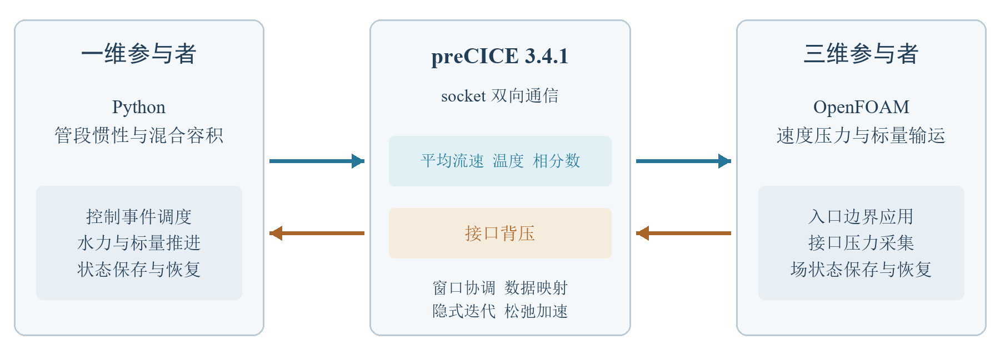
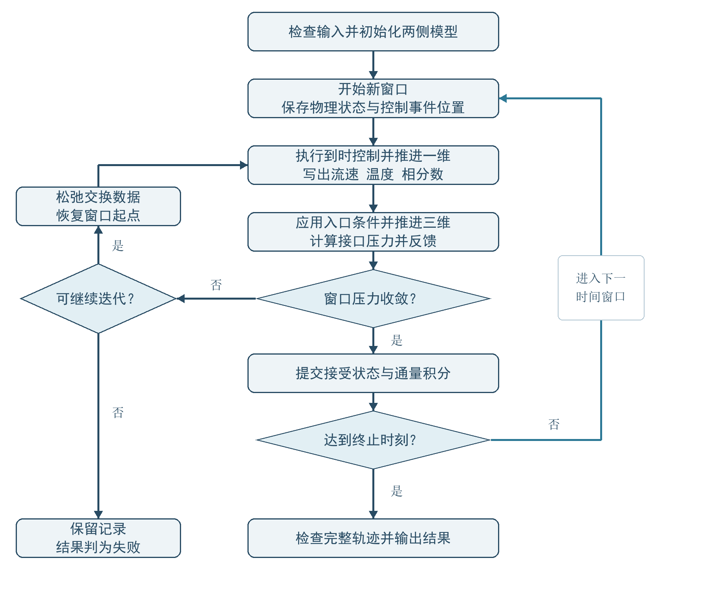
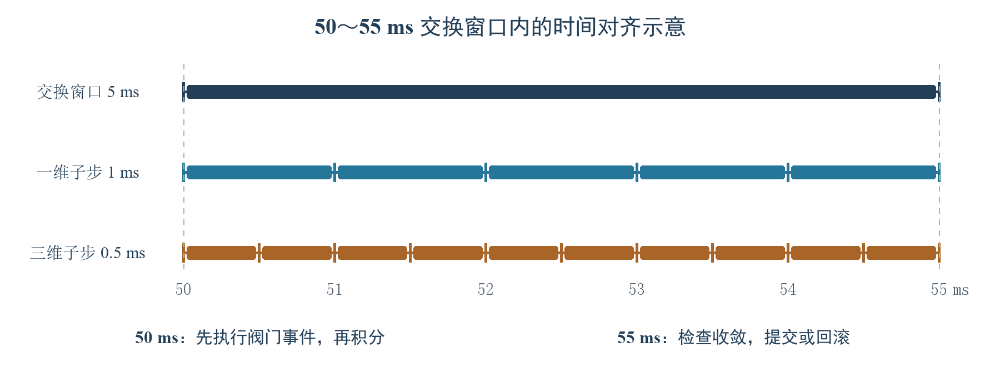

# 一三维耦合方案说明

## 1 目标和范围

在管路输运与阀门控制问题中，既需要了解系统整体流量如何随控制动作变化，也需要掌握局部流场的速度、压力、温度和相分数分布。一维模型计算量较小，适合描述管路的整体响应；三维 CFD 模型能够分辨局部流动细节，但计算成本较高。将两者连接起来，可以在保留关键局部信息的同时，利用一维模型完成系统侧的快速计算。阀门动作会改变流量，下游流场形成的背压又会影响上游，因此需要使两个模型持续交换信息，共同求解同一段输运过程。

本方案基于 preCICE 3.4.1 框架开展二次开发，实现一维管路模型与 OpenFOAM 三维模型的双向耦合。preCICE 提供两个模型之间的数据通信和耦合迭代功能。在此基础上，本方案编写一维管路及阀门控制程序，并完善三维侧的数据读写接口，使一维计算的流速、温度和相分数能够作为三维入口条件，三维计算的背压能够返回一维模型。方案重点解决边界条件的对应、不同时间步长的协调，以及毫秒级控制动作与物理求解的同步问题。

模型适用于定密度不可压缩层流，包含单管段和充分混合容积；两相采用等密度、等黏度、等热容与同速假设。温度和相分数参与无扩散对流输运，不改变混合物物性。相变、滑移、表面张力、浮力、可压缩压力波及空化不在本模型范围内。反向输送所需的上游状态接口尚未配置，因此程序在出现反向质量输送时终止计算。

## 2 总体架构与执行流程

系统由一维参与者和三维参与者两个求解进程组成，两侧均通过 preCICE 接口加入同一耦合会话。以下先说明各部分职责，再按一个交换窗口的完整生命周期介绍执行流程。

### 2.1 总体架构

一维侧采用 Python 管段惯性模型与混合容积，接收阀门事件并计算出口状态；三维侧采用 OpenFOAM 2512 求解速度、压力及标量输运，返回共同截面的面积平均压力。图 1 展示两侧通过 preCICE 交换数据的关系，平均流速、温度、相分数和反馈压力均经由 socket 通道传递。

数据交换时，程序将一维的截面平均状态转换为三维入口边界，并将三维入口压力汇总后返回一维。两侧按共同的交换窗口协调各自的内部步长，逐步求得流量与背压相互影响的计算结果。

### 2.2 执行流程

一次计算从输入检查开始，按窗口迭代推进，直到达到规定物理终止时刻。每个窗口只有形成可接受的耦合状态后，才进入下一段物理时间。具体流程如下。

（1）检查与初始化。检查几何、物性、初值、步长和控制事件的合法性，生成三维网格与耦合配置。统一接口面积、速度剖面和初始状态，启动两个参与者，建立 socket 连接并交换初始化数据。

（2）保存窗口起点。进入新窗口时，根据 preCICE 的检查点请求保存一维状态、控制事件位置，以及三维已注册场与旧时间场。这些状态是本窗口重复试算的共同起点。

（3）推进一维模型。在每个一维子步起点先处理到时的控制事件，再确定允许步长，读取该子步所需的压力反馈。用更新后的阀门状态推进水力方程和混合容积，将新的平均流速、温度与相分数写入 preCICE，并通知框架本次推进时长。窗口内的多个子步共同形成状态时间序列。

（4）推进三维模型。三维适配器在求解时刻读取正向状态并转换为入口边界，按自身内部步长推进速度、压力及标量方程。适配器采集接口压力，通过 preCICE 返回一维侧，形成同一窗口内的双向反馈。

（5）判断与重算。两侧完成当前窗口的试算后，由 preCICE 判断压力相对收敛情况。若未满足条件，则经 Aitken 松弛更新交换数据，并要求参与者恢复窗口起点；随后重新执行一维推进和三维推进。每次重算使用相同的控制事件时序。

（6）提交与结束。框架确认窗口完成后，保存接受轨迹、控制事件和通量积分，再开始下一窗口。结束后检查收敛记录、轨迹完整性、场误差及收支残差；达到最大迭代次数但未收敛的窗口不能通过最终结果检查。运行失败时保留已有记录并结束关联进程。

上述步骤构成图 2 所示的执行流程。图中的内层循环用于在同一时间窗口内反复求解，直到压力反馈满足收敛条件；外层循环用于推进后续时间窗口。每次进入新窗口保存一次起点状态，重算则恢复该状态并重新执行相同的控制事件。

## 3 模型方程与数值方法

模型方程决定了每个参与者能够表达的物理过程，也是接口变量和守恒统计的依据。下面先说明一维侧如何更新流量与混合状态，再说明三维侧如何求解速度、压力和标量输运，从而明确两侧共享的假设与各自的计算职责。

### 3.1 一维水力及混合状态

一维侧将管段内的轴向惯性和沿程阻力集中描述，以较低计算成本给出随压力反馈变化的平均流速。温度与相分数另用充分混合容积更新，使水力响应和标量储存具有明确的物理含义。

管段截面积 $A=\pi R^2$，平均轴向速度 $u$ 满足：

$$\rho L\frac{du}{dt}=p_s-p_b-Ku,\qquad K=\frac{8\rho\nu L}{R^2}+K_v(a^{-2}-1).$$

其中 $a$ 为阀门开度，$p_s$ 为供压，$p_b$ 为三维反馈压力。子步内保持 $p_b,a$ 常值，令 $\lambda=K/(\rho L)$、$u_\infty=(p_s-p_b)/K$，则

$$u(t+\Delta t)=u_\infty+[u(t)-u_\infty]e^{-\lambda\Delta t}.$$

程序解析积分 $u,u^2,u^3$，用于质量、动量、压力功、耗散和接口动能通量计算。理想完全关闭时立即停止，并记录冲量与损失动能；该近似不能用于水锤精度评价。

充分混合容积 $V_m$ 满足

$$\rho V_m c_p\frac{dT}{dt}=\dot m c_p(T_s-T),\qquad
\rho V_m\frac{d\alpha}{dt}=\dot m(\alpha_s-\alpha).$$

对任意子步积分质量 $m$，精确更新

$$Y_{n+1}=Y_s+(Y_n-Y_s)e^{-m/(\rho V_m)},\quad Y=T,\alpha.$$

水力惯性体积 $AL$ 与混合储存体积 $V_m$ 是两个独立集中模型，不能把两者的储存项当作同一空间体积重复相加。

### 3.2 三维方程

三维侧需要将一维给出的截面平均状态转化为局部场，并计算沿程压降对上游的反馈。速度与压力的耦合求解提供水力闭环，温度和相分数输运则用于检验标量信息在空间传播过程中的准确性。

速度和压力由不可压缩 Navier–Stokes 方程、PIMPLE 压力速度耦合求解；标量方程为

$$\partial_t T+\nabla\cdot(\boldsymbol U T)=S_T,\qquad
\partial_t\alpha+\nabla\cdot(\boldsymbol U\alpha)=S_\alpha.$$

时间采用 Euler，标量对流采用有限体积 upwind，标量线性求解容限为 $10^{-11}$。正式物理输运算例源项为零；制造解算例显式声明数学源项。相分数不做事后裁剪，越界由验证器报告，以保留真实收支误差。

## 4 接口定义与空间映射

相同的变量名称并不意味着两侧采用相同的数值含义。例如，三维求解器中的压力按密度归一化，而一维模型使用有量纲压力；如果直接交换而不换算，就会产生系统性偏差。因此需要同时约定字段、单位、采样位置和应用方式。下表列出实际交换字段，随后说明符号与参考状态。

表 1 接口字段与单位约定

| 字段 | 方向 | 含义与单位 | 实际应用 |
| --- | --- | --- | --- |
| Velocity | 1D → 3D | 平均轴向速度，m/s；$\dot m=\rho A u$ | 转换为入口抛物线速度剖面 |
| FlowTemperature | 1D → 3D | 温度，K | 均匀入口标量边界 |
| Alpha | 1D → 3D | 相 A 体积分数，无量纲 | 均匀入口相分数边界 |
| Pressure | 3D → 1D | 三维内部为运动学表压，m²/s²；一维乘密度得到 Pa | 面积加权后作为一维出口压力 |

接口为一维出口与三维入口的共同截面。三维域的远端出口表压固定为零；反馈的是三维下游域作用于一维的接口背压。不能把远端固定零压直接作为动态反馈。

坐标沿 $+z$ 为正，1D 输出的正流量进入 3D。OpenFOAM 边界通量以域外法向为正，统计三维入口时取负号。显热 $h=c_p(T-T_{ref})$，算例选 $T_{ref}=300$ K；不包含潜热和化学能。当前等密度条件下体积分数等于质量分数，$\alpha_B=1-\alpha_A$，两相通量之和等于总通量。

Velocity/Pressure 使用轴向多尺度网格映射；温度和相分数采用独立标量接口网格的 consistent 最近邻映射。标量接口网格属于同一对模型，用于保持标量的均匀入口含义。

### 4.1 截面投影与初场一致性

一维平均量需要展开为三维面元值，同时保持指定流量。投影时先统一离散截面面积，再归一化速度剖面，以减小几何离散与初始边界不一致造成的偏差。

圆形截面由离散平面面元组成，面积 $A_h$ 与 $\pi R^2$ 有差别。启用接口面积归一化时，将挤出网格的 $x$、$y$ 坐标同乘 $s=\sqrt{A/A_h}$，保证离散截面积等于一维面积。$R$ 因而解释为面积等效半径；有限多边形的边界形状误差仍需网格细化。

入口取 $f_i=2(1-r_i^2/R^2)$，并归一化为

$$U_{z,i}=u\,f_i/\langle f\rangle_A,\qquad
\langle f\rangle_A=\sum_i A_i f_i/A.$$

初始三维内部剖面使用同一归一化系数，减少入口与初场不匹配造成的启动脉冲。几何参数、缩放系数和离散剖面矩随运行结果保存。

离散动量与动能修正系数为

$$\beta_h=\sum_i A_i(U_{z,i}/u)^2/A,\qquad
\gamma_h=\sum_i A_i(U_{z,i}/u)^3/A.$$

理想连续圆管的系数分别为 $4/3$ 和 2。报告同时保留连续系数的偏差及使用 $\beta_h,\gamma_h$ 后的离散一致性残差；后者不能替代空间离散误差评价。

## 5 时间步长协调机制

两侧求解器的内部步长由各自的离散精度和求解成本决定，边界交换则需要共同的物理时间区间。方案采用固定交换窗口内的子循环：允许一维与三维使用不同内部步长，但两侧必须在窗口边界完成耦合一致性检查。

### 5.1 时间尺度与步长约束

记一维和三维内部最大步长为 $\Delta t_1$、$\Delta t_3$，交换窗口长度为 $H$，窗口起点为 $t_n$。完整窗口的端点满足

$$t_{n+1}=t_n+H.$$

内部子步可以比交换窗口更短，也可在到达窗口边界前截短。对一维侧，实际步长取配置上限、preCICE 当前允许推进时长以及下一控制事件剩余时间三者的最小值：

$$\delta t_1=\min\left(\Delta t_1,\Delta t_{\mathrm{pc}},t_e-t\right).$$

其中 $t$ 为当前物理时刻，$t_e$ 为下一尚未执行的事件时刻；没有后续事件时省略第三项。到时事件先执行，再计算下一子步。$\Delta t_{\mathrm{pc}}$ 由框架给出，用于保证推进不越过当前耦合边界。三维侧由 OpenFOAM 适配器协调配置步长与框架允许时长，使其在同一窗口端点停靠。

当前交换窗口在一次运行中保持固定。内部步长与窗口可以采用不同尺度；当配置步长不能整除窗口时，末子步需要缩短，不能通过越过窗口端点来凑整。

### 5.2 窗口内子循环与数据读取

以阀门输运算例为例，交换窗口为 5 ms，一维内部步长为 1 ms，三维内部步长为 0.5 ms。一个完整窗口内，一维推进 5 个子步，三维推进 10 个子步；发生隐式重算时，这些子步还会重复执行。图 3 展示 50～55 ms 窗口中的时间刻度，50 ms 阀门事件在该窗口起点生效。

交换字段启用窗口内子步数据，preCICE 保存相应的时间序列，并在读取时按参与者请求的相对时间提供数据。三维无需等待每一个一维子步都使用相同编号，一维也无需使用三维的内部步长；双方通过物理时间和窗口边界建立对应关系。一维以子步末端的相对时间读取压力，在该子步内按常值反馈进行解析推进。

因此，缩短交换窗口和缩短内部步长具有不同作用：前者增加形成耦合一致状态的频率，后者改善各自的时间离散。评价参数时应分别检查状态轨迹、积分残差和试算次数。

### 5.3 窗口收敛与回滚

本方案采用串行隐式耦合，依次进行一维状态计算和三维压力反馈。压力相对收敛判据默认设为 $10^{-4}$，最大迭代次数为 60；Aitken 初始松弛因子默认取 0.2，后续松弛由框架更新。框架负责收敛判断及回滚请求，参与者负责实际保存和恢复其物理状态。

回滚恢复整个窗口起点，而不是只修改最新的接口压力。一维恢复时间、速度、阀门开度、混合温度、相分数和控制事件游标；三维恢复适配器已登记的场及旧时间场。未接受的轨迹暂存在试算缓冲中，重复计算结束后仅提交最终接受轨迹。三维完整试算日志在分析时按时间回退截去旧后缀，并检查接受轨迹连续覆盖终止时刻。

压力端点收敛还需结合窗口内轨迹检查解释。强瞬态工况下，可采用窗口和两侧步长相等的配置，使每个离散端点都参与耦合检查；相应试验见第 10 章。

## 6 毫秒级控制与物理求解同步

阀门动作改变一维阻力，并通过流量影响三维流场和反馈压力。如果控制动作只按程序运行顺序触发，物理时刻可能随求解成本变化。方案因此用仿真时间调度事件，使动作先于对应时间段的物理积分生效，并在窗口重算中保持一致。

### 6.1 控制时钟与事件对齐

控制逻辑采用预定阀门事件表，控制时钟周期 $\tau_c=1\,\mathrm{ms}$。事件时刻 $t_e$ 必须同时位于控制时间网格和交换窗口边界；从零时刻开始的固定窗口运行满足

$$t_e=m\tau_c=nH,\qquad m,n\in\mathbb{Z}_{\geq 0}.$$

输入检查会拒绝未对齐的事件。这意味着 1 ms 控制时钟规定可表达的事件时间精度，但在 5 ms 交换窗口配置中，事件仍需安排在共同边界上。若需要每隔 1 ms 改变命令，应选取能与这些时刻对齐的交换窗口。事件之间保持最近一次阀门开度。

### 6.2 控制动作进入双向求解的顺序

以 50 ms 时阀门开度从 1.0 变为 0.4 为例，前一窗口先推进至 50 ms 并完成收敛。新窗口保存检查点后，一维事件调度器识别该动作，在从 50 ms 开始的方程积分前更新开度和阻力。因此，50～51 ms 的一维子步已经使用新的开度。

一维根据更新后的阻力和当前压力反馈计算流速，再推进混合温度与相分数，将子步状态经 preCICE 传递给三维侧。三维按自身子步读取对应时刻的边界并求解，计算出的接口压力再进入同一窗口的一维重算。阀门效应由此进入流量与背压的闭合迭代，而不是在三维完成旧窗口后再修改结果。

同步对象是方程开始使用控制命令的物理时刻。事件触发时，流量和压力仍按所选物理模型演化，不能把连续状态响应误解为所有流场在该时刻同时跳变。

### 6.3 重放一致性与同步误差

在窗口起点保存检查点时，同时保存控制事件游标。若本窗口需要重算，阀门状态和事件游标一并恢复；再次推进时，在相同物理时刻重新执行该事件。试算事件记录随回滚清空，最终只保存接受窗口的事件记录，避免重算次数影响动作次数。

每个事件记录预定时刻 $t_{\mathrm{scheduled}}$ 与实际方程生效时刻 $t_{\mathrm{applied}}$，同步误差定义为

$$\varepsilon_t=t_{\mathrm{applied}}-t_{\mathrm{scheduled}}.$$

检查最大绝对误差小于 $10^{-12}$ s，并核对事件顺序、次数与接受轨迹。该指标评价仿真物理时间的对齐。当前实现按事件表更新命令，未包含每毫秒根据测量值重新计算控制量的反馈控制律；求解器墙钟耗时与状态显示刷新周期分别统计，不作为物理事件时刻。

## 7 边界条件一致性与守恒检查

一维出口与三维入口共同构成内部耦合截面。两侧需要描述相同的流动状态，并在统一物理时刻满足流量、压力及标量的对应关系。本章先说明物理求解器如何设置边界，再说明如何核对边界值与积分收支。第 4 章给出的空间映射用于实现这些条件，第 5、6 章的时间协调用于保证它们在正确时刻生效。

### 7.1 物理边界条件的对应关系

水力求解采用速度传入、压力反馈的配合方式。一维根据上游供压和三维背压求出出口平均流速，三维将其展开为入口速度剖面，再由压力方程计算与该流量相容的接口压力。该压力返回一维后参与下一次耦合迭代，直到窗口内的压力反馈满足收敛要求。表 2 汇总物理算例中的边界设置。

表 2 一维与三维模型的边界条件

| 边界位置 | 水力条件 | 温度与相分数条件 |
| --- | --- | --- |
| 一维上游 | 指定供压，阀门开度决定附加阻力 | 指定供给温度与供给相分数，经过混合容积更新出口状态 |
| 一维出口与三维入口 | 一维输出流速；三维入口施加对应速度剖面，压力由求解获得并返回一维 | 三维入口施加一维传来的温度与相分数 |
| 三维远端出口 | 表压固定为零，速度采用零法向梯度 | 无源项输运算例采用零法向梯度 |
| 三维管壁 | 无滑移速度，压力采用零法向梯度 | 零法向梯度；本模型扩散系数为零，壁面无穿透 |

三维入口速度采用固定值边界，由适配器随交换数据更新；入口压力采用与给定通量相容的外推压力边界。压力边界中的初始值用于启动计算，随后反馈压力由三维求解结果确定。三维远端出口的零表压为整个系统提供统一的压力参考，一维供压也采用相同表压基准。制造解诊断算例的标量出口使用与指定解析梯度对应的边界条件，并同时设置匹配源项。

### 7.2 流量与压力的接口一致性

流量一致性要求一维输出的体积流量等于进入三维域的体积流量。设一维平均速度为 $u$，三维入口面元面积为 $A_i$，轴向速度为 $U_{z,i}$，则接口关系为

$$Q_{1}=Au=\sum_i A_iU_{z,i}=-\sum_i\phi_i=Q_{3,\mathrm{in}}.$$

其中 $\phi_i$ 是 OpenFOAM 按域外法向定义的面体积通量，因此三维入口取负号。第 4 章的面积修正和剖面归一化保证所施加速度剖面的面积积分与一维流量对应；求解后的实际面通量仍需单独检查，以观察压力速度修正和时间离散带来的偏差。

压力反馈采用同一入口截面的面积平均值。设 $\pi_i$ 为三维求解器中的运动学表压，$p_i$ 为有量纲表压，则一维出口背压为

$$p_b=\rho\frac{\sum_i A_i\pi_i}{A}=\frac{\sum_i A_ip_i}{A},\qquad p_i=\rho\pi_i.$$

两侧使用相同密度和压力参考，反馈压力因而对应三维入口截面的压力合力。一维表示截面平均状态，三维保留面元间的变化；接口压力的一致性按面积平均意义评价，局部压力分布仍由三维方程决定。

### 7.3 标量边界与物理时刻的一致性

温度和相分数的入口值来自一维混合容积的出口状态。对同一物理时刻 $t$，三维各入口面元采用相同的标量值：

$$T_{3,i}(t)=\widetilde{T}_1(t),\qquad\alpha_{3,i}(t)=\widetilde{\alpha}_1(t).$$

带波浪号的量表示 preCICE 在请求时刻提供的一维时间序列值；当两侧内部步长不同时，由窗口内数据读取建立时间对应关系。边界状态检查将三维实际应用值与同一物理时刻的一维值比较。控制动作、混合容积状态和边界时间序列在窗口回滚时一并重放，使每次试算采用一致的物理时序。

初始化时，三维内部速度剖面与入口采用相同的归一化方式，初始温度和相分数与一维混合状态一致。运行后分别检查入口状态误差、压力轨迹及两侧通量积分：边界值相符说明数据施加正确，累计通量残差则反映一段时间内的实际输运是否一致。两类检查共同评价耦合效果。

### 7.4 窗口收支与能量诊断

对每个已收敛窗口，分别积分两侧通量，并在相同时间区间内比较收支。表 3 并列列出一维解析积分和三维实际面通量积分，用于检查单位、方向与积分口径。

表 3 收敛窗口内的两侧通量积分

| 量 | 一维接口积分 | 三维接口积分 |
| --- | --- | --- |
| 质量 | $\rho A\int u\,dt$ | $-\rho\int\sum_i\phi_i\,dt$ |
| 相 A | 混合容积精确流出质量 | 相分数离散矩阵面通量 |
| 显热 | 混合容积精确流出显热 | 温度离散矩阵面通量减参考温度通量 |
| 轴向对流动量 | $\rho A\beta\int u^2dt$ | $\int\sum_i\dot m_i U_{z,i}dt$ |
| 压力力冲量 | $A\int p_bdt$ | $\int\sum_i p_i A_i dt$ |
| 动能通量 | $\rho A\gamma\int u^3dt/2$ | $\int\sum_i\dot m_i|U_i|^2dt/2$ |
| 压力功 | $A\int p_bu\,dt$ | $\int\sum_i p_i\dot m_i/\rho\,dt$ |

总能量接口诊断是显热、动能通量和压力功之和。压力采用 Pa；三维内部运动学压力参与压力功时按密度换算。

三维域内另计算质量、相 A、显热、动量、机械能的“储存变化 + 净流出 − 源项”残差。标量通量来自离散矩阵，与实际方程一致；动量与机械能采用重构面应力和连续收支公式，存在离散与重构误差。黏性耗散未加入温度方程，记为向恒温背景输出的热量。

令窗口残差为 $r_k=I_{1,k}-I_{3,k}$。同时报告 $|\sum r_k|/\sum|I_{1,k}|$、$\sum|r_k|/\sum|I_{1,k}|$ 和 $\max|r_k|$，避免正负抵消掩盖局部误差。零通量附近优先检查有单位的绝对残差。完整系统机械能尚未实现严格闭合，需同时检查分项残差。

为区分压力功误差的来源，另用面积平均压力计算投影功 $W_A$，将一维压力功 $W_1$ 与三维面通量压力功 $W_3$ 的差分解为

$$W_1-W_3=(W_1-W_A)+(W_A-W_3).$$

前一项反映时间轨迹及积分差异，后一项反映空间压力投影差异。该分解用于定位误差，实际两侧收支仍独立保留。系统能量审计分别报告外边界机械能与热量残差，并以供压功和供给热量归一化；耗散按向恒温背景输出热量处理，不通过补偿项强制闭合。

## 8 评价指标

结果检查同时覆盖物理精度、接口收支、控制同步和运行完整性。表 4 给出本项目采用的数值检查门槛；这些阈值用于所声明工况的结果评价。

表 4 误差指标与检查门槛

| 指标 | 定义与统计口径 | 检查门槛 |
| --- | --- | --- |
| 界面状态误差 | 相同物理时间下 3D 入口与 1D 插值值的最大差/RMS | $T$ < $10^{-8}$ K；$\alpha$ < $10^{-10}$ |
| 稳态水力误差 | 末端速度、压力与 Poiseuille 解析值之差除以参考值 | 速度误差 < 3%；同时报告压力误差及细化趋势 |
| 物理标量场误差 | 相对独立特征线解析解的体积加权场 RMS | 最大 $T$ RMS < 1 K，$\alpha$ RMS < 0.03（输入幅度的 5%） |
| 制造解误差 | 相对显式指定制造解的体积加权场 RMS | 最大 $T$ RMS < 0.1 K，$\alpha$ RMS < 0.003 |
| 标量累计守恒 | 窗口残差累计值除以通量绝对积分 | 质量、显热、相 A 各 < 1% |
| 控制同步误差 | 实际方程生效仿真时刻减预定时刻 | 最大绝对值 < $10^{-12}$ s |
| 稳定性 | 全部窗口收敛、轨迹完整、场值有限、$\alpha$ 有界 | 所有条件均须满足 |

端到端延迟采用同容器单调时钟测量：正向从一维写出前至三维边界读取应用后，反向从三维写出前至一维压力读取并换算后。按可观测源样本的首次接收使用统计 $p_{50}$、$p_{95}$、$p_{99}$ 和最大值，保留样本数；测量包含初始化、隐式试算和时间戳读写，窗口内插值不保证逐样本一一确认。

计算成本记录完整墙钟耗时、试算子步与接受子步之比，以及读取、模型计算、写出和推进等待等分项。推进等待包含远端 CFD 求解和同步。独立通信微基准采用一顶点 socket 耦合，并扣除本地操作成本，所得增量包含框架调度等待，其规模与完整面网格运行不同。

交换周期采用“最短已测试稳定周期”表述，并同时给出工况、网格、步长和运行时长。性能统计用于评价计算成本，毫秒级物理时间交换不意味着具备墙钟硬实时能力。

## 9 运行管理与复现

双进程耦合中，单侧异常可能使另一侧持续等待。运行管理因此将输入检查、参与者监管和结果发布连贯处理，并保留用于追溯的配置与日志。

启动前检查非法物性、非有限初值、网格参数、事件对齐和解析算例的适用条件。运行时若任一参与者非零退出，监管进程结束其余参与者；超时同样按失败处理。每个接受窗口追加保存物理状态和控制事件，运行状态在结果复制完成后发布。

失败后保留输入、日志和已有接受记录，支持诊断与从原始输入重新运行。接受窗口日志用于结果恢复与检查，不用于直接续接已中断的 preCICE 会话。已完成的双侧故障注入测试在 10 s 门槛内结束关联进程，重新运行得到相同物理轨迹。

复现材料保存输入、网格与耦合配置、源码快照及校验值、依赖清单和固定容器镜像。运行入口在统一环境中完成网格生成、初场设置、双向求解与结果检查；部署命令和操作步骤在运行手册中说明。

## 10 试验探索

探索试验围绕时间尺度、空间分辨率、迭代参数和重复控制展开，用于解释误差来源并确定适用配置。以下概括与方案选择直接相关的结果，完整数据和曲线见算例验证报告。

### 10.1 时间尺度与迭代参数

交换窗口扫描在已测试工况下覆盖至 31.25 μs，并包含一维 1 ms、三维 0.125 ms、窗口 5 ms 的不同步长组合。试验说明不同内部步长可以在共同窗口中协调；最短已测试周期的结论仅适用于对应网格、工况和持续时间。

对于强瞬态压力一致性，采用窗口与两侧步长均为 0.125 ms、初始松弛因子为 0.5 的配置。三组重复中的压力轨迹相对差为 0.004940%，低于预设 0.1% 门槛；试算放大倍数下降 21.93%。这一设置使全部离散端点参与耦合检查，多子步配置仍采用默认初始松弛因子 0.2。迭代次数的改善不能直接等同于各硬件平台上的墙钟加速。

### 10.2 网格与时间离散

分别开展时间细化、空间细化及联合细化，以判断标量场误差和接口积分残差对不同离散参数的敏感性。在已测试输运工况中，网格细化对场误差改善更明显，时间细化主要降低显热接口积分残差。

联合细化采用每块径向 8 格、轴向 80 格的网格，一维与三维步长分别为 0.25 ms 和 0.125 ms。温度场均方根误差从 0.501090 K 降至 0.311888 K，降幅 37.76%；显热接口累计残差从 0.347173% 降至 0.087038%。该配置适用于关注温度输运精度的相应算例。

### 10.3 重复控制与模型适用性

重复控制试验覆盖 2 s 物理时长、20 次阀门动作和 2000 个收敛窗口，用于检查事件顺序、状态连续性和重复反馈。结合第 6 章的同步误差记录，可确认控制动作在声明的物理时刻进入求解过程；该证据范围限于已完成的循环时长。

另以独立径向非定常 Stokes 模型分析瞬态速度剖面假设的敏感性。由于边界条件与三维算例不同，该参考用于解释模型差异；正式解析验证由稳态圆管水力和无源项标量输运两类算例承担。两类算例内部均使用同一对一维与三维模型进行双向交换。
