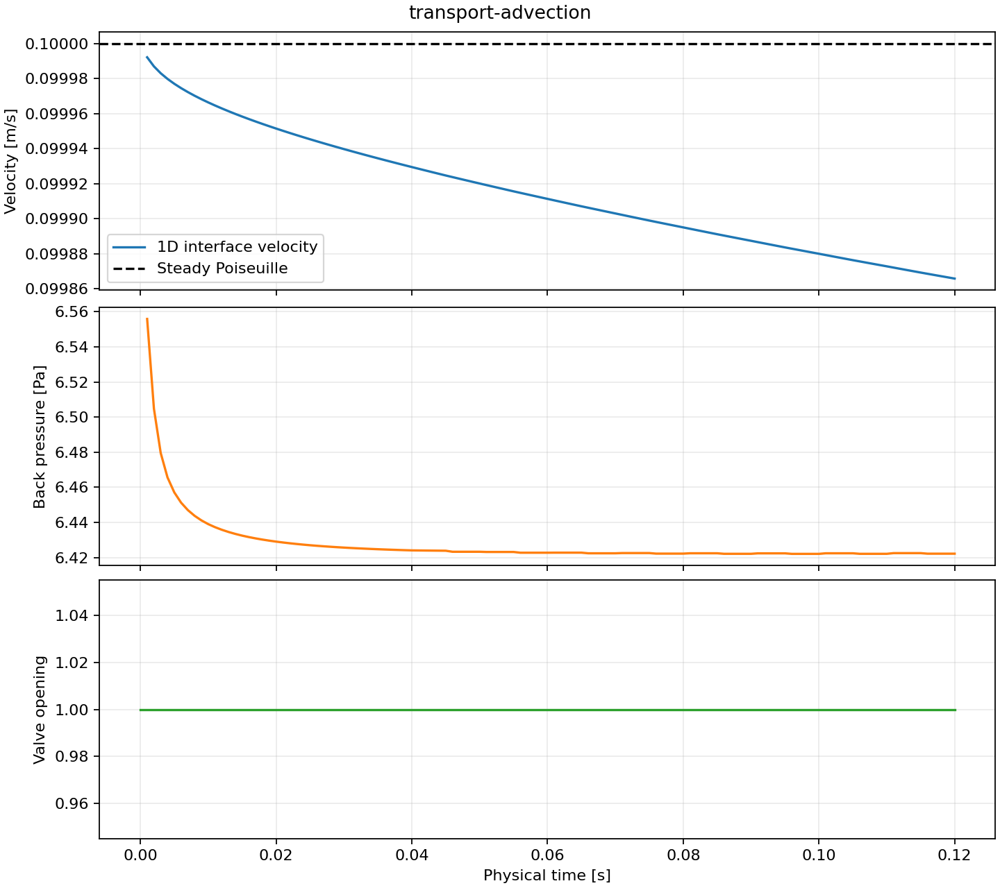
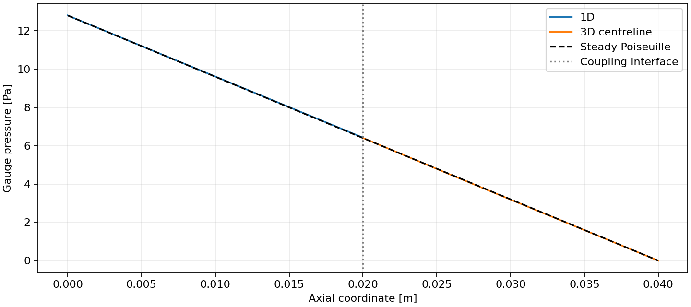
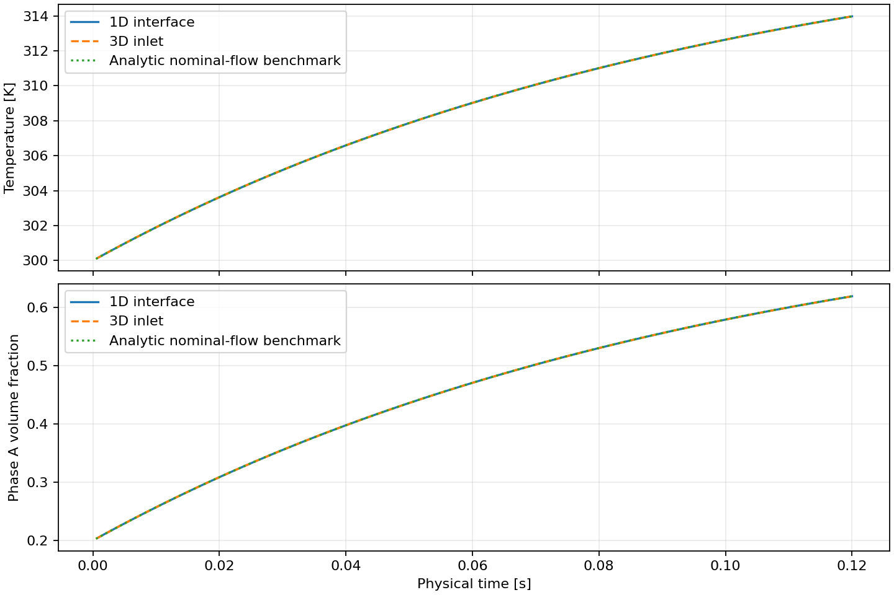

# 运行报告：transport-advection

## 运行结果

- 物理终止时间：0.12 s。
- 交换窗口：0.005 s；一维最大子步 0.001 s；三维最大子步 0.0005 s。
- 完整运行墙钟耗时：35.1629 s；接受 24 个窗口。
- 控制事件：0 次；最大仿真时间注入误差 0 s。
- 正向延迟 p50 / p95 / max：1.28381 / 2.43726 / 4.63232 ms，41 个源样本。
- 反向延迟 p50 / p95 / max：14.9014 / 36.9359 / 126.435 ms，41 个源样本。
- 瞬时离散入口体积流量映射最大残差：2.71051e-20 m³/s。

延迟按每个已观测源样本在接收侧第一次可用的时间统计，包含隐式试算和时间戳文件开销。同一容器的两个进程使用 CLOCK_MONOTONIC，原始时间戳保留于 traces/ 与 reverse_latency.csv。

## 验证范围

一维采用均匀不可压缩管道惯性及准稳态 Poiseuille 摩擦；三维为实际 OpenFOAM pimpleFoam 层流计算。温度与相 A 体积分数通过 preCICE 传入三维入口，并实际求解输运方程。两相等密度、等热容、同速；热能采用显热参考状态。一维混合容积与管道机械能分别记账。三维动量残差采用重构面应力诊断，尚未构成完整总能量闭合。

稳态 Poiseuille 参考速度为 0.1 m/s；本次末端速度 0.0998657 m/s。稳态末端相对误差为 0.00134275，应结合收敛与网格研究使用。

## 输出

- [量化摘要](summary.json)
- [接受步日志](pipe.csv)
- [一维进程日志](pipe.log)、[OpenFOAM 日志](foam.log)
- [固定输入](case.json)、[耦合配置](precice-config.xml)
- [上游来源](source_manifest.json)、[容器镜像信息](docker_image.json)

## 温度、相分数与窗口收支

- 温度／相分数界面最大偏差：1.08002e-12 K / 1.88738e-15。
- 质量／显热／相 A 窗口积分累计相对残差：2.79678e-06 / 0.0034728 / 0.00192965。
- 三维显热／相 A 单步收支最大残差：1.37096e-09 J / 2.72109e-18 kg。
- 三维轴向动量累计诊断残差：-2.56538e-11 kg·m/s。
- 接受三维步 240，原始试算步 410；回滚时丢弃旧轨迹后缀。

本算例采用无源项对流特征线解析解，误差同时包含水力场、入口混合状态和标量离散误差。

- [窗口账本](window_balances.csv)、[三维接受步](foam_accepted.csv)、[温度相分数摘要](transport_summary.json)。
