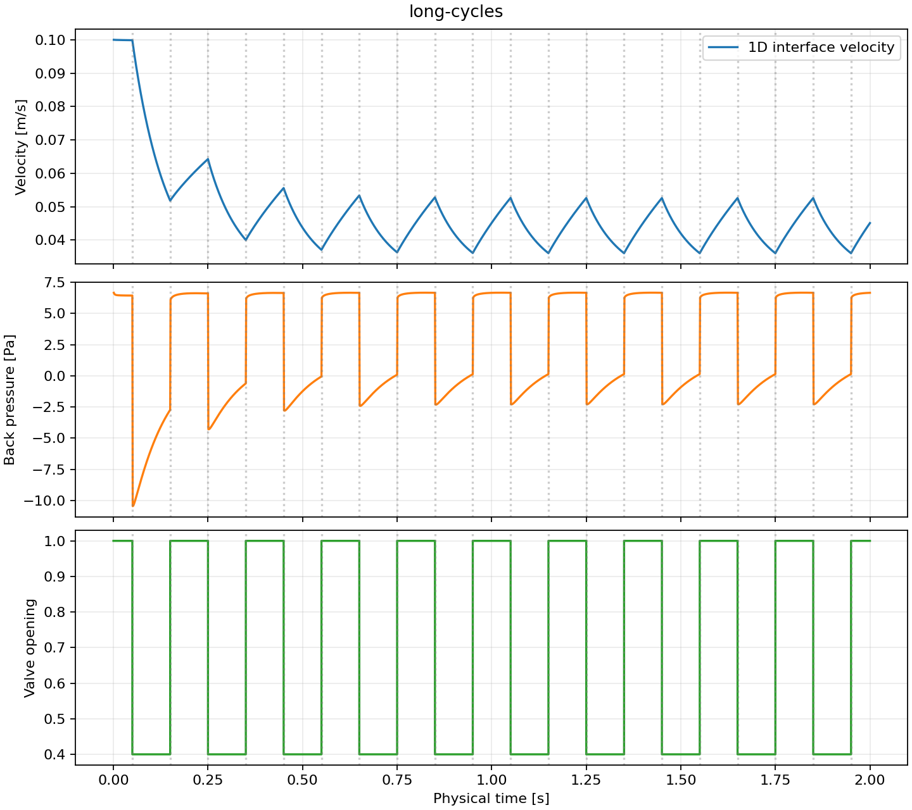
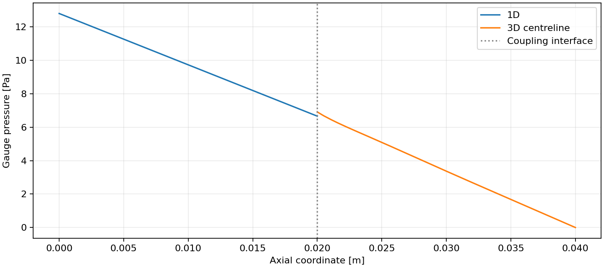
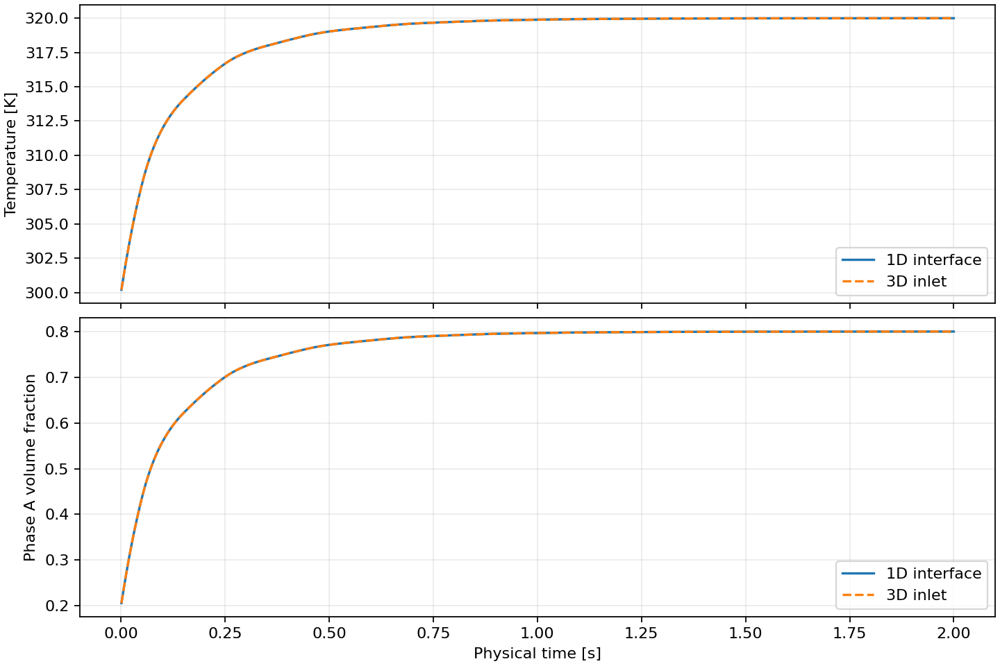

# 运行报告：long-cycles

## 运行结果

- 物理终止时间：2 s。
- 交换窗口：0.001 s；一维最大子步 0.001 s；三维最大子步 0.001 s。
- 完整运行墙钟耗时：237.752 s；接受 2000 个窗口。
- 控制事件：20 次；最大仿真时间注入误差 1.04583e-13 s。
- 正向延迟 p50 / p95 / max：1.30833 / 2.33178 / 9.06763 ms，5250 个源样本。
- 反向延迟 p50 / p95 / max：0.996685 / 16.2689 / 270.292 ms，5250 个源样本。
- 瞬时离散入口体积流量映射最大残差：1.77877e-20 m³/s。

延迟按每个已观测源样本在接收侧第一次可用的时间统计，包含隐式试算和时间戳文件开销。同一容器的两个进程使用 CLOCK_MONOTONIC，原始时间戳保留于 traces/ 与 reverse_latency.csv。

## 验证范围

一维采用均匀不可压缩管道惯性及准稳态 Poiseuille 摩擦；三维为实际 OpenFOAM pimpleFoam 层流计算。温度与相 A 体积分数通过 preCICE 传入三维入口，并实际求解输运方程。两相等密度、等热容、同速；热能采用显热参考状态。一维混合容积与管道机械能分别记账。三维动量残差采用重构面应力诊断，尚未构成完整总能量闭合。

稳态 Poiseuille 参考速度为 0.1 m/s；本次末端速度 0.0451042 m/s。本算例存在控制瞬态，稳态解析值不用于判定瞬态波形准确性。

## 输出

- [量化摘要](summary.json)
- [接受步日志](pipe.csv)
- [一维进程日志](pipe.log)、[OpenFOAM 日志](foam.log)
- [固定输入](case.json)、[耦合配置](precice-config.xml)
- [上游来源](source_manifest.json)、[容器镜像信息](docker_image.json)

## 温度、相分数与窗口收支

- 温度／相分数界面最大偏差：1.02318e-12 K / 2.77556e-15。
- 质量／显热／相 A 窗口积分累计相对残差：0.000283374 / 0.000264797 / 0.000116113。
- 三维显热／相 A 单步收支最大残差：3.52907e-09 J / 2.37795e-15 kg。
- 三维轴向动量累计诊断残差：-6.84826e-08 kg·m/s。
- 接受三维步 2000，原始试算步 5250；回滚时丢弃旧轨迹后缀。

本算例没有制造源项，展示阀门反馈与温度、相分数的实际输运。

- [窗口账本](window_balances.csv)、[三维接受步](foam_accepted.csv)、[温度相分数摘要](transport_summary.json)。
