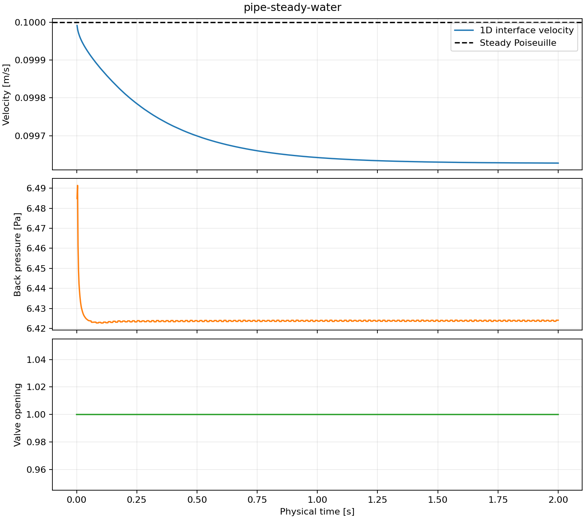
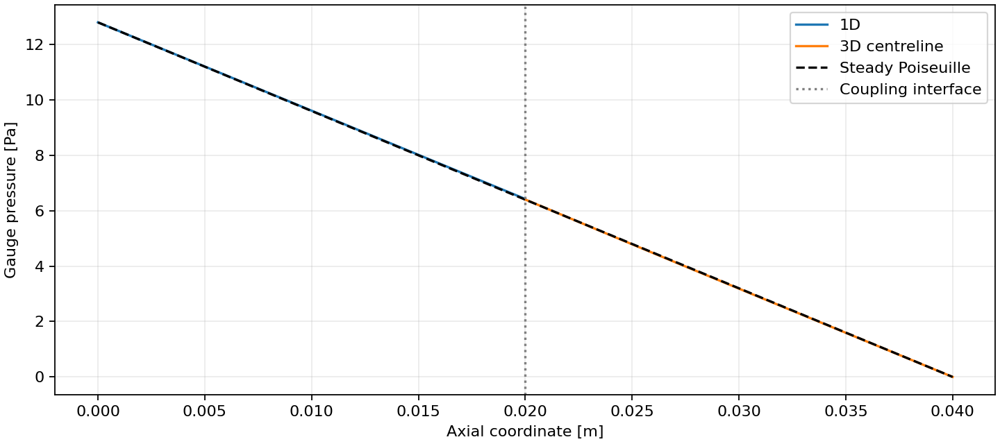

# 运行报告：pipe-steady-water

## 运行结果

- 物理终止时间：2 s。
- 交换窗口：0.01 s；一维最大子步 0.002 s；三维最大子步 0.0025 s。
- 完整运行墙钟耗时：35.1857 s；接受 200 个窗口。
- 控制事件：0 次；最大仿真时间注入误差 0 s。
- 正向延迟 p50 / p95 / max：0.661263 / 1.11061 / 1.90511 ms，236 个源样本。
- 反向延迟 p50 / p95 / max：0.680105 / 29.0857 / 211.677 ms，236 个源样本。
- 瞬时离散入口体积流量映射最大残差：2.87991e-20 m³/s。

延迟按每个已观测源样本在接收侧第一次可用的时间统计，包含隐式试算和时间戳文件开销。同一容器的两个进程使用 CLOCK_MONOTONIC，原始时间戳保留于 traces/ 与 reverse_latency.csv。

## 验证范围

一维采用均匀不可压缩管道惯性及准稳态 Poiseuille 摩擦；三维为实际 OpenFOAM pimpleFoam 层流计算。温度与单相标记作为记录元数据。入口映射残差验证离散剖面的总流量，完整窗口及系统质量、动量、能量收支尚需扩展。

稳态 Poiseuille 参考速度为 0.1 m/s；本次末端速度 0.0996273 m/s。稳态末端相对误差为 0.00372702，应结合收敛与网格研究使用。

## 输出

- [量化摘要](summary.json)
- [接受步日志](pipe.csv)
- [一维进程日志](pipe.log)、[OpenFOAM 日志](foam.log)
- [固定输入](case.json)、[耦合配置](precice-config.xml)
- [上游来源](source_manifest.json)、[容器镜像信息](docker_image.json)
